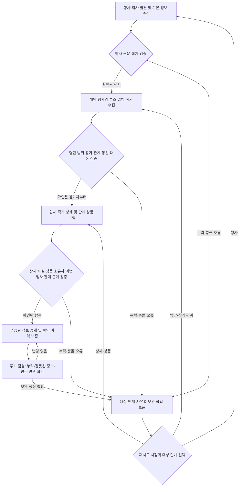

# 서브컬처 탐색과 관심 알림 및 수집기 개편 계획

## 2026-10-15 사용자 확정 사항 — 행사부터 단계적으로 수집하고 반복 검증

수집의 기본 순서는 **행사·회차 → 그 행사에 참가하는 부스·업체·작가 → 업체·작가 상세와 판매 상품 → 주기적인 누락 보완·오류 정정**이다. 한 번의 실행으로 모든 정보를 확보했다고 가정하지 않는다. 이 절이 아래 탐색 순서 설명보다 우선하며, 기존 지역·분야 범위와 자동 검토 정책은 유지한다. 후속 graph-5 로컬 구현에서 15개 분류의 단계별 큐·구조화된 문제·시도 이력·주기 갱신을 추가했다. 운영 배포·DB 적용·예약 활성화는 실행하지 않았다. 실제 적용·검증 범위는 `collector/GRAPH_WORKER_KO.md`를 따른다.

### 단계별 수집·검증 기준

| 단계 | 수집 대상 | 검증 및 다음 작업 |
| --- | --- | --- |
| 1. 행사 | 정확한 회차, 일정, 장소, 주최사, 공식 출처, 참가 명단·배치도 링크 | 같은 이름의 다른 회차를 구분한다. 확인된 행사별로 참가 수집 작업을 만든다. 명단 미발표는 대기 사유로 남긴다. |
| 2. 부스·업체·작가 | 부스 번호·구역·참가일, 참가 업체/브랜드/서클, 구성 작가와 공식 계정 | 명단 페이지·원문 총수와 대조하고 중복·누락·공동 부스 구성 관계를 확인한다. 확인된 참가자부터 상세 수집을 진행하고 남은 명단은 이어 수집한다. |
| 3. 상세·판매 상품 | 업체·작가 소개, 공식 채널, 상품명·옵션·가격·판매표·판매 기간·출처 | 다른 업체/작가의 상품 혼입과 이전 회차 판매표를 검사한다. 일반/과거 상품은 이번 행사 판매 근거가 있을 때만 해당 회차에 연결한다. 작품·캐릭터 분석은 확인된 상품의 후속 작업이다. |
| 4. 주기 점검·보완 | 모든 단계의 누락, 잘못된 값·연결, 취소·일정 변경, 명단·판매표 갱신 | 빈 필드뿐 아니라 이미 채운 사실도 원문과 재대조한다. 문제 단계로 돌아가 재수집·검토한 뒤 공개본을 갱신하고, 정정된 관계에 의존하는 검색·알림도 재평가한다. |

부스는 해당 행사 회차의 참가 단위이고 업체·작가는 여러 행사에서 재사용하는 대상이다. 공동 부스에는 여러 업체·작가가 연결될 수 있으며, 부스명과 작가명을 같다고 가정하지 않는다. 부스 번호가 아직 없어도 근거가 있는 참가 사실은 보존한다. 상품 자체와 특정 행사에서의 판매 사실도 구분한다.

### 반복 수집과 완료 판정

- 각 단계는 `수집 → 원문·기존 정보 대조 → 별도 자동 검토 → 서버 검증 → 확인된 항목 반영`을 거친다. 부족하거나 충돌하는 부분은 보완 작업으로 되돌린다. 확인된 행사 정보는 하위 상품 수집이 끝나기 전에도 공개할 수 있다.
- 행사 하나에 단일 완료 표시를 붙이지 않는다. 행사 기본 정보, 명단 범위, 업체·작가 식별/상세, 판매 상품을 각각 추적한다. 실행 성공·작업 큐 소진은 전체 수집 완료를 의미하지 않는다.
- 미수집, 부분 수집, 공식 미발표, 접근 실패, 근거 충돌, 해당 없음, 범위 내 확인 완료를 구분한다. 이는 업무 상태 기준이며 기존 DB enum을 새로 적용했다는 뜻은 아니다. 판매표를 못 찾은 경우를 상품 없음으로 확정하지 않는다.
- 대상 ID·회차·단계·원문 URL·확인 시각/해시·수집 범위·다음 페이지/묶음·미해결 사유·마지막 시도·다음 확인 시각을 보존한다. 오류 정정은 이전 값과 새 근거, 관련 판정 이력을 남긴다.
- 페이지가 남았거나 원문 총수와 맞지 않으면 부분 수집이다. 총수를 모르면 확인한 페이지/출처 범위만 기록하며 전체 확보를 선언하지 않는다. 검증된 일부 항목은 유지하고 남은 부분만 이어 처리한다.
- 미시도 대상, 오래 남은 누락, 일정이 임박한 행사의 변경·오류를 처리 우선순위에 반영한다. 접근 실패에는 백오프를 적용하고, 새 행사 발견과 기존 대상 보완 모두 실행 기회를 보장한다.
- 주기 점검에서 원문이 일시적으로 비거나 접근에 실패했다는 이유만으로 기존 상품·참가 관계를 삭제하지 않는다. 잘못된 관계나 철회는 근거를 다시 검토하고 정정한다.

### 구조 적용 확인 사례

1. 행사는 확인됐지만 명단이 미발표면 행사를 보존하고 명단 재확인 작업을 남긴다.
2. 참가 명단 일부만 수집됐으면 확인된 부스부터 상세를 조사하고 남은 페이지를 재개한다.
3. 공동 부스의 두 작가는 각각 식별하고 상품을 실제 판매자·제작자 근거에 맞게 연결한다.
4. 판매표를 확보하지 못한 업체는 판매 정보 미확인으로 남기고 다음 주기에 보완한다.
5. 값이 모두 채워진 행사라도 일정 변경·취소·잘못된 상품 귀속을 발견하면 정정한다.
6. 중단 후 재실행해도 기존 ID와 확인된 항목을 유지하며 중복 상품·중복 알림을 만들지 않는다.

현재 코드와 이 기준의 대응 및 추가 구현 확인 항목은 [수집기 구조 설명](../../collector/GRAPH_WORKER_KO.md#2026-10-15-수집-흐름-기준과-현재-구현의-대응)을 참조한다.

## 2026-10-08 사용자 확정 사항 — 아래 이전 제안보다 우선

이 절은 계획 변경이며 수집기 실행·운영 설정 적용·DB 마이그레이션 완료를 뜻하지 않는다.

후속 구현: 020/021 추가형 스키마, 이미지 묶음 검토·식별 연결/해제·작가 공지의 행사 재발견, v6 영속 큐, 분리된 추출/검토 호출과 자동 공개 경로를 로컬에 구현했다. 전체 전환은 미완료이고 배포하지 않았다. 실제 구현·테스트·남은 리뷰 항목은 `collector/GRAPH_WORKER_KO.md`를 참조한다.

### 범위와 탐색 순서

- 작품이나 행사 일부만 선별하는 운영 범위 제한을 두지 않는다. 기존 서비스의 서브컬처 지역/분야 범위 안에서 발견된 전체 행사를 대상으로 한다. 전체 인터넷 자료의 확보를 보장한다는 뜻은 아니며, 접근 실패·미발표·미수집 범위를 별도로 기록한다.
- 주 경로는 위 2026-10-15 기준을 따른다. 행사/회차에서 부스·업체·작가를 찾고 확인된 참가자부터 상세·판매표를 조사한다. 남은 명단 페이지와 누락 정보는 별도 작업으로 계속 처리한다. 상품별 작품·캐릭터 분석은 후속 작업이며, 해당 회차 참가·판매 근거 검증을 생략하지 않는다.
- 작가는 여러 행사에서 같은 안정 ID를 재사용하며, 행사 조사와 별도로 갱신할 수 있다. 작가 계정에서 다른 참가 행사를 발견하면 행사 큐로 되돌린다.
- 한 판매표에 여러 작가·작품·캐릭터가 섞일 수 있다. 상품 단위와 이미지 영역별 근거를 보존하고, 전체 판매표의 태그를 모든 상품에 복사하지 않는다. 세트/콜라보 상품은 복수 캐릭터를 연결할 수 있다.
- 그림만으로 불명확한 캐릭터는 UNKNOWN/AMBIGUOUS로 남기고 이름·작품 후보를 보완한다. 이미지를 처리할 수 없는 경우 텍스트만 본 결과를 시각 확인으로 표시하지 않는다.
- 작가의 과거/일반 상품 분석과 해당 행사 판매 확인을 분리한다. 공식 상품 글·판매표·참가 공지의 정확한 회차/날짜 근거가 있어야 행사 판매로 공개한다.

### 사람 검토 없는 LLM 자동 검토·공개

- 운영자가 모든 후보를 승인하는 절차를 필수 경로에서 제거한다. 수집, 보완, 검토는 6.1 Sol을 사용한다.
- 추출 호출과 검토 호출을 분리한다. 검토 호출은 원문/이미지 근거, 기존 식별 후보, 충돌 사실을 확인해 승인·반려·보완 필요로 판정한다. 같은 모델의 다른 호출은 독립 모델 합의나 정확성 보장을 의미하지 않는다.
- LLM의 확신 점수만으로 공개하지 않는다. 서버에서 스키마, FK, 회차·부스·상품 소속, 근거 존재, 현재 공개 상태, 대상 revision, 승인된 이미지 권리 조건을 검사한다.
- 미확인·충돌은 사람 대기함에 강제로 보내지 않고 후속 보완 또는 재확인 대기로 남긴다. 충분히 확인된 행사/작가 정보는 먼저 공개하되 미확정 캐릭터 관계는 공개하지 않는다.
- 자동 검토 결과에 observation ID/해시, target revision, 판정 사유, 모델·프롬프트·스키마 버전을 남긴다. 근거나 대상 버전이 변경되면 이전 승인을 재사용하지 않는다.
- 기존 사람 검토 API에 가짜 사용자 ID를 넣지 않는다. 시스템 검토 주체 및 최소 권한의 내부 후보·판정 API를 추가하고, 최종 공개는 서버 검증을 거친다. 관리자 정정 기능은 예외 대응용으로 유지한다.
- 반복 실패/모호성에는 최대 연속 시도 후 냉각 시간을 적용하고 새로운 원문/변경이 있을 때 재개한다. 미해결을 사실의 부재로 해석하지 않는다.

### 모델과 실행 정책

- 사용자 지정 모델: 6.1 Sol. CLI 호출에서는 명시 모델을 사용하고 null/기본 모델 의존을 제거한다. 배포 호스트에서 해당 모델 식별자와 텍스트·이미지 입력 지원을 사전 점검하고 실행 결과의 실제 모델을 기록한다. 지원하지 않거나 호출이 거절되면 실패 상태로 남기며 다른 모델로 조용히 대체하지 않는다.
- 월/일 비용 및 총 호출량 상한을 두지 않는다. 사용량·호출 수·오류·처리량 측정은 유지한다.
- 기존 maxEvents/maxParticipantPages/maxSales/maxCliCalls는 전체 수집 종료 기준으로 그대로 사용하지 않는다. 작업 묶음 크기와 실행 시간은 유지하되 미처리 페이지/대상은 서버 큐에 남겨 후속 실행이 이어받는다.
- 호출 타임아웃, 공급자 rate limit 준수, 출처별 동시성, 백오프, lease, 반복 URL/문서 해시 감지는 유지한다. 비용 제한과 장애·무한 반복 제어를 구분한다.
- 신규 발견 조사와 기존 대상 갱신 큐를 분리하고 양쪽에 실행 기회를 보장한다. 인기 대상만 처리하면서 나머지가 영구 대기하지 않게 한다.

### 마이그레이션에 미치는 변경

- 019의 사용자 관심/subject ID는 유지하고 후속 마이그레이션으로 시스템 검토 주체, 후보/근거/판정 이력, 독립 작가 공개본, 관계와 작업 큐를 추가한다. 현재 reviewed_by 필수 사용자 FK를 그대로 시스템 검토에 사용하지 않는다.
- 기존 reviewed_by/검토 이력은 보존한다. 기존 문자열 subjects는 언급 후보로 옮긴 후 LLM이 작품·캐릭터를 판별하고 근거를 검토한다. 미확정 문자열은 확정 ID로 강제 변환하지 않는다.
- 기존 행사/참가/상품/작가 ID와 후기·보관함의 참조를 유지한다. 기존 상품의 행사별 판매 정보를 보존하면서 독립 상품 대응 관계를 추가한다.
- 모든 항목은 이전 실행 ID, 원본 PK/revision, 매핑 결과/실패 사유를 기록하여 재실행 가능하게 한다. 새 결과는 먼저 비공개 비교로 검증하고 전체 범위를 순차 전환한다. 검증용 소규모 실행은 수집 대상 범위 제한이 아니다.
- 이전된 과거 정보는 기준 데이터로 기록하여 신규 알림을 생성하지 않는다. 정식 전환 이후의 검토된 공개 변경만 알림 생성 대상으로 삼는다.

### 운영 완료 기준

모든 발견 행사/명단 페이지/작가/판매표는 완료, 미발표, 접근 제한, 재시도 대기, 식별 미확정 중 명시적 상태를 갖는다. 캐릭터 미확정 때문에 행사 전체를 막지 않는다. 자동 공개된 모든 관계에는 추적 가능한 근거와 판정 이력이 있어야 하며 동일 입력 재처리는 중복 대상·중복 알림을 만들지 않아야 한다. 작업자 종료 후 재개, 검토 이후 원문 변경, 잘못된 병합의 정정도 검증한다.

---

2026년 10월 8일 기준. 캐릭터·작가를 중심으로 탐색하고, 새로운 참가·판매 소식을 받아 실제 방문 계획으로 연결한다. 알림 채널은 사용자가 선택한 사이트 알림함과 선택형 웹 푸시로 구성한다. 아래 주기·처리량·묶음 정책은 구현 초기 설정안이며 운영 예약이나 발송을 실행한 상태는 아니다.

**재검토한 실행 방향**

이번 재검토는 현재 작업 트리의 코드·설정과 앞선 계획을 대조한 결과다. 운영 서버의 배포 상태나 실제 수집 품질을 검증한 결과는 아니다. 제품 코드는 변경하지 않았다. 기존 분야 도메인 구분, 행사 안의 작가·상품 검색, 시리즈, 후기, 보관함을 재사용한다. 새 핵심은 독립 작가·상품 카탈로그와 근거가 있는 관계, 양방향 탐색, 관심 알림이다.

사용자가 확정한 요구는 서브컬처 경험 분리와 분야 전환의 푸터 이동, 행사·작가의 독립 다중 출처 수집, 관계 보완, 캐릭터·작가 알림함과 선택형 웹 푸시, 지난 회차 후기다. 이번 단계는 서브컬처에 한정하고 박람회·축제의 탐색 경험 개편은 별도 범위로 둔다. 기술적으로는 기존 프런트·백엔드·DB를 공유하고 서브컬처의 화면·공개 조회·수집 범위를 분리한다.

재검토 후 보완한 결정은 다음과 같다.

| 발견한 빈틈 | 이번 계획에 반영한 결정 |
| --- | --- |
| 독립 사이트 기반·검색·후기를 모두 신규로 보면 중복 개발이 발생함 | 현재 구현과 실제 신규 기능을 구분한 비교표를 21번에 추가 |
| 기존 구현 순서에서 홈·헤더와 과거 후기가 마지막에 몰려 있음 | A에서 화면 구조를 잡고 C에서 양방향 탐색과 과거 회차 후기를 완성, 알림보다 먼저 데이터 의미 검증 |
| 상품 독립 수집의 설명은 있으나 DB 표와 화면 저장 흐름이 덜 구체적임 | 독립 상품 관측·공개본, 행사별 판매 연결, 행사 미정 저장을 명시 |
| 문자열 subjects와 캐릭터의 확정 관계가 섞일 수 있음 | 별칭 후보와 검토된 ID를 구분하고 관계의 종류·적용 회차·근거를 저장 |
| 검색 데이터 부족을 판매 없음으로 해석할 수 있음 | 판매 확인 / 미발표 / 미확인 / 확인 불가를 구분하고 빈 결과의 다음 행동을 제공 |
| 독립 작가를 기존 로그인 CREATOR 역할과 혼동할 수 있음 | 외부 작가 ID와 사용자 계정을 분리하고 기존 소유권 인증으로만 관리 권한 연결 |
| 검색 공개본과 알림이 서로 다른 버전을 읽을 수 있음 | 첫 구현은 동일 PostgreSQL 공개 조회 모델을 사용하고 공개 버전·변경·outbox를 함께 저장 |
| 예시 한도와 배포용 설정 한도가 다름 | 일일 공통 예산 도입 전에 실제 적용 설정을 확인하고 작업별 사용량을 측정 |

화면·DB·수집·보완·알림의 상세는 1~13·16~20·22~23번, 수정한 실행 순서는 14번, 기존 대비 변경은 21번을 기준으로 한다. 모델 기본값은 20번에 실제 로컬 조회 결과를 반영했다.

**1. 목표와 범위**

완성할 대표 흐름은 캐릭터 또는 작가 검색 → 관심 등록 → 새 참가·판매 공지 수집 → 근거와 연결 검토 → 공개 → 알림 → 해당 상품·부스 상세 → 날짜별 내 방문 저장이다. 기존 행사 중심 탐색도 같은 상세 화면과 방문 목록을 사용한다. 작가와 행사는 각각 독립적으로 발견·갱신하고 여러 출처의 관측을 연결한다. 연속 개최 행사는 시리즈 안에서 회차를 구분하며 현재 행사에서 이전 회차 후기를 읽고 그 회차에 후기를 작성할 수 있게 한다.

첫 적용 대상은 기존 서비스 범위인 서울·경기 서브컬처 행사다. 캐릭터의 일반 SNS 언급, 작가의 모든 일상 게시물, 해외·온라인 판매 전체를 알림 대상으로 확장하지 않는다. 행사 참가와 판매, 프로그램에 연결된 확인 가능한 소식을 제공한다. 행사와 연결되지 않은 일반 상품은 별도 판매 범위로 보관할 수 있지만 행사 판매 알림을 만들지 않는다.

관심 등록은 계속 소식을 보고 싶은 대상을 지정하는 행동이며, 내 방문 저장은 특정 행사·날짜에서 할 일을 지정하는 행동이다. 두 관계를 별도로 보관한다. 웹 푸시는 관심 등록과 별도로 명시적으로 활성화한다. 기존 보관함 저장을 알림 동의로 소급 해석하지 않는다. 방문 계획의 변경 알림은 사용자가 별도로 켜며, 비회원의 로컬 저장은 서버 알림 대상에 포함하지 않는다.

**2. 현재 구현에서 재사용할 부분**

| 확인한 코드 | 현재 역할 | 변경 방향 |
| --- | --- | --- |
| frontend/src/components/layout/PublicLayout.tsx | 분야 전환 헤더와 보관함·계정 진입 | 서브컬처 탐색 메뉴, 알림함, 관심 관리 진입 추가 |
| frontend/src/features/discovery/site.ts | 분야 도메인 판별과 전환 플래그 | 서브컬처 화면 및 푸시 등록 origin 결정에 재사용 |
| database/006_subculture_catalog.sql | 외부 작가·서클, 행사 참가, 판매 관측, 공개 스냅샷 | ID를 유지하고 작품·캐릭터·상품 관계 확장 |
| backend/src/main/java/com/boothhana/collection/CatalogPublicationService.java | 검토 결과로 공개 스냅샷 생성 | 공개 버전과 의미 있는 변경, 알림 처리 대기 기록을 같은 트랜잭션에 저장 |
| backend/src/main/java/com/boothhana/support/OwnershipCatalogService.java | 인증된 운영자의 수정과 공개 정보 반영 | 동일한 변경 감지 경로로 통합 |
| collector/weekly.py | 발견·행사 검증·참가·판매 순차 처리 및 한도 관리 | 독립 작업을 등록하는 호환 진입점으로 축소 |
| collector/event_queue.py, discovery_work.py | 로컬 JSON 기반 후보 및 반복 조사 대기열 | 서버 작업 대기열로 점진적으로 이관 |
| collector/x_recent.py | 토큰이 있을 때 X 최근 검색으로 후보 확보 | 접근 가능한 선택형 출처 어댑터로 재사용 |
| collector/floorplans.py, interactive_floorplan.py | 배치도 발견·검토·좌표 관련 처리 | 날짜별 장소 자료 작업으로 연결 |
| frontend/src/features/library, features/offline | 저장·메모·방문 기록·오프라인 자료 | 내 방문 흐름과 연결 |
| frontend/public/library-sw.js | 루트 범위 오프라인 워커 진입 파일 | 실제 등록 경로를 확인한 뒤 푸시 핸들러와 통합 |
| database/018_verified_organizers_series.sql, OwnershipCatalogService.java | 시리즈·회차 연결과 다른 공개 회차 조회 | 시리즈 후보 보완, 지난 회차 판정, 회차별 후기 진입 |
| frontend/src/features/catalog/EventComments.tsx, backend/src/main/java/com/boothhana/collection/EventComments.java | 행사별 후기·댓글과 특정 회차의 날짜별 자료 합산 | 기존 글·권한 유지, 회차 선택·표시, 특정 ID 예외를 명시적 회차 매핑으로 이관 |

확인한 범위에 팬 관심 등록과 웹 푸시 구독·발송 모델은 없다. 기존 수집 결과에는 출처·확인 범위·커서·검토 상태가 있어 이를 버리지 않는다. 기존 코드의 단일 활성 pipeline 제약을 그대로 둔 채 여러 worker만 띄우는 방식은 사용하지 않는다.

**3. 화면 구성과 알림 설정**

데스크톱 헤더는 행사 찾기 / 작품·캐릭터 / 작가·서클 / 굿즈를 중심으로 통합검색, 알림, 내 방문, 내 정보를 배치한다. 분야 전환은 푸터에 둔다. 모바일은 홈 / 탐색 / 내 방문 / 내 정보와 상단 알림 버튼으로 구성한다.

분야 전환은 실제 다른 분야 사이트의 주소로 연결하고 현재 분야를 표시한다. 기존 헤더의 서브컬처·박람회·축제 링크를 서브컬처 내부 탐색 메뉴로 교체한다. 서브컬처 화면의 브랜드 설명과 푸터 문구도 해당 이용 목적에 맞춘다. 행사 상세 내부의 홈·부스·후기 전환은 분야 전환과 별개의 기능이므로 유지할 수 있다.

비회원·관심 미등록 홈에는 통합검색, 다가오는 행사, 최근 확인된 판매 정보와 작품·작가 탐색 진입을 제공한다. 관심 등록 후에는 내 관심 소식과 관련 예정 행사, 저장한 방문 계획을 우선 배치한다. 관심을 등록하지 않아도 모든 공개 탐색이 가능하다. 이번 단계의 추천은 확인된 관심 관계와 일정 기반이며 별도의 행동 예측 모델을 만들지 않는다.

내 방문에는 날짜별 계획과 미배정 보관함을 함께 제공한다. 행사 미정 독립 상품은 일반 저장으로 남기고, 확인된 판매 행사를 사용자가 선택한 뒤 그 날짜의 방문 항목으로 연결한다. 기존 내 예약은 내 정보·내 방문에서 접근을 유지하고 실제 예약 내역임을 구분한다. 상품의 외부 선입금 안내와 개인 구매 체크를 부스하나 예약 완료로 표시하지 않는다.

캐릭터·작가 상세와 검색 결과에는 관심 등록 버튼을 제공한다. 등록 직후 사이트에서 받을 소식 종류를 확인하고, 별도 버튼으로 이 기기의 웹 푸시를 켤 수 있게 한다. 비회원은 공개 탐색과 기존 임시 보관함을 이용하고, 지속적인 관심 알림 등록 시 로그인 후 원래 대상으로 복귀한다.

| 화면 | 필요한 동작 |
| --- | --- |
| 캐릭터 상세 | 소속 작품·별칭 확인, 관련 굿즈·행사 탐색, 관심 등록·해제 |
| 작가·서클 상세 | 공식 계정과 구성 관계, 참가 예정·판매물, 관심 등록·해제 |
| 관심 관리 | 대상별 소식 종류, 일시 중지, 지역 조건, 푸시 수신 방식 설정 |
| 알림함 | 전체·안 읽음, 관심 대상별 필터, 묶음 상세, 읽음·전체 읽음, 해당 대상 알림 끄기 |
| 알림 상세 | 무엇이 바뀌었는지, 해당 행사·참가일, 확인 시각, 출처, 알림을 받은 이유 |
| 내 방문 | 행사·날짜별 저장 목록, 구매·수령 메모, 배치도, 중요한 변경 표시 |
| 기기 관리 | 현재 기기 수신 상태, 다른 기기 구독 해제, 잠금 화면 내용 숨김 선택 |
| 행사 후기 | 이번 회차 후기·질문과 지난 회차 후기를 구분, 회차·날짜·장소 표시, 선택한 과거 회차에 작성 |

알림 예시는 ‘관심 작가 A의 11월 행사 참가가 확인됐어요’, ‘관심 캐릭터 B 관련 판매물이 C 행사에 추가됐어요’다. 처음 수집한 항목을 신상품이라고 단정하지 않고 ‘새로 확인한 판매 정보’라고 표현한다. 푸시를 누르면 알림 ID로 사이트에 진입하여 현재 권한·공개 상태를 확인한 뒤 구체적인 상품·부스·행사로 이동한다.

**4. 알림 종류와 연결 조건**

| 종류 | 발생 조건 | 수신 대상 | 초기 전달 정책 |
| --- | --- | --- | --- |
| 작가 참가 확인 | 해당 회차의 작가 또는 서클 참가가 새로 검토·공개됨 | 그 작가·서클의 관심 사용자 | 알림함과 당일 소식 묶음 |
| 캐릭터 관련 행사 확인 | 캐릭터와 행사의 직접 관계 또는 확인된 참가·판매 관계가 새로 공개됨 | 그 캐릭터의 관심 사용자 | 알림함과 당일 소식 묶음 |
| 판매 정보 추가 | 행사 판매 근거가 있는 상품·판매표가 추가됨 | 관련 캐릭터 또는 제작 작가 관심 사용자 | 작가·행사 단위로 묶음 |
| 선입금·예약 시작 | 공식 시작 시간 또는 실제 접수 개시가 확인됨 | 해당 종류를 선택한 관련 관심 사용자 | 알림함과 허용 시간 내 우선 푸시 |
| 접수 마감 임박 | 종료 시간이 확정되고 사용자가 마감 알림을 선택함 | 관련 관심 사용자 | 초기값은 마감 24시간 전 1회 |
| 일정·장소·부스 위치 변경 | 공개된 값이 근거와 함께 실제 변경됨 | 해당 종류를 선택한 관련 관심 사용자, 변경 알림을 켠 관련 방문 계획 사용자 | 중복을 합친 우선 알림 |
| 참가 철회·행사 취소 | 명시적인 취소·철회 근거가 검토됨 | 변경 전 관계의 관련 관심 사용자, 변경 알림을 켠 관련 방문 계획 사용자 | 중복을 합친 우선 알림 |

관심 캐릭터 알림은 검토된 character ID와 연결된 관계에 한정한다. 작품 전체가 언급됐다고 그 작품의 모든 캐릭터에 알림을 만들지 않는다. 공동 부스의 상품은 제작자가 확인된 경우에만 그 작가 상품으로 연결한다. 공동 부스 참가 소식은 확인된 구성 관계에 따라 보낼 수 있지만 상품 제작 사실까지 확장하지 않는다.

같은 변경이 캐릭터와 작가 양쪽에 해당하면 사용자에게 한 번만 보낸다. 알림 상세에는 두 관심 대상이 모두 이유로 나타날 수 있다. 같은 캐릭터의 다른 상품들이 같은 행사 참가 사실을 반복해서 알리지 않도록 캐릭터·행사·알림 종류 단위로 그룹화한다.

기본값은 선택한 대상의 사이트 알림 활성, 웹 푸시 비활성이다. 푸시를 켜면 일반 소식은 매일 19시 KST 묶음, 일정 변경·취소·접수 시작은 09~21시 내 우선 전달을 초기값으로 한다. 야간에는 알림함에 바로 기록하고 푸시는 다음 허용 시각으로 미룬다. 그때 이미 마감된 접수 소식은 푸시하지 않는다. 사용자가 묶음·즉시 방식을 바꿀 수 있게 한다.

소식이 없는 날은 보내지 않는다. 데이터 정렬·공백·원문 URL 추가·수집 시각 변경은 알림 사유가 아니다. 가격 정정은 기본적으로 상세와 저장 목록에 표시하고, 별도의 할인·재입고 알림은 신뢰할 수 있는 근거 체계를 갖춘 뒤 추가한다.

**5. 수집기의 일곱 작업 유형**

일곱 작업 유형은 각각 실행·재시도·중지할 수 있는 논리 단위다. 서버나 배포 서비스를 일곱 개로 나누는 의미는 아니다. 처음에는 공통 Python worker와 작업 유형별 handler를 사용한다. 모든 작업은 동일한 출처 레지스트리, 가져오기 캐시, 추출 결과 저장소, 검증기를 공유한다. 이 일곱 작업 위에 누락·미완료·오래된 정보·오류를 찾아 작업을 배정하는 보완 조정기를 둔다. 보완기는 별도 여덟 번째 크롤러가 아니라 기존 일곱 작업을 목적별로 다시 실행시키는 제어 역할이며, 상세 규칙은 16번에 명시한다.

| 번호와 작업 유형 | 한 작업의 범위 | 입력·출처 | 저장 결과 | 다음 작업 |
| --- | --- | --- | --- | --- |
| 1 DISCOVER | 발견 대상 종류·출처 또는 검색 묶음 하나와 기간 한 구간 | 행사장 일정, 주최 계정, 예매처, 작품·캐릭터 별칭, 작가·굿즈 검색, 커뮤니티 단서 | 행사명·공지 URL·작가 계정·상품 후보와 발견 근거 | EVENT 또는 CREATOR 또는 독립 상품 검토 |
| 2 EVENT | 행사 후보 또는 확인된 회차 하나 | 주최 공식 사이트·게시물·장소 일정 | 회차, 날짜, 장소, 입장, 상태, 연결 출처 | PARTICIPANTS, PROGRAMS, VENUE_ASSETS |
| 3 PARTICIPANTS | 행사 회차·명단 출처·페이지 하나 | 공식 명단, 부스 인포, 회차가 확인되는 참가자 공지 | 참가 부스, 구성 작가, 실제 참가일, 부스 번호, 공식 계정 | CREATOR, SALES |
| 4 CREATOR | 작가·서클 하나의 출처별 변경 구간 | 공식 사이트·복수 공식 계정·프로필 링크·작가가 운영하는 판매처 | 작가 독립 프로필, 작품·캐릭터 취급 근거, 상품 후보, 참가·판매표·예약 링크 | EVENT, SALES |
| 5 SALES | 작가 또는 행사 참가 부스의 판매 출처 페이지·판매표 이미지 하나 | 판매표, 작가 상품 페이지, 행사 상품 페이지, 접근 가능한 공식 판매·접수 안내 | 상품·캐릭터·제작자와 근거, 행사별 판매 연결은 별도, 가격·판매 범위·접수 시각 | 관계 검토와 공개 후보 |
| 6 PROGRAMS | 행사·프로그램 출처 페이지 또는 시간표 하나 | 주최 시간표·시연·무대·사인회 안내 | 프로그램, 참여 대상, 날짜·시간, 위치, 신청 조건 | 관계 검토와 공개 후보 |
| 7 VENUE_ASSETS | 행사·날짜·자료 버전 하나 | 공식 배치도, 홀 안내, 부스컷·판매표·상품 이미지 후보 | 배치도·이미지 근거, 검토된 위치 연결, 승인된 저장 파일 | 검토와 공개 후보 |

작품·캐릭터 정규화는 공통 후처리다. 기존 사전에 없는 이름은 후보로 등록하고, 정식 이름·별칭·소속 작품·근거를 검토한다. 캐릭터마다 인터넷 전체를 매번 재검색하지 않는다. 검토된 별칭으로 1번에서 발견하고, 확인된 작가·행사 출처를 2~5번에서 추적한다.

1번과 4번은 서로 다른 방향의 입구다. 참가 명단이 공개되기 전에도 작가가 발표한 참가를 발견할 수 있다. 행사 실체와 해당 회차가 확인되면 작가 공지를 근거로 참가를 검토할 수 있으며, 공식 명단 전체 공개를 무조건 기다리지 않는다. 추후 명단과 충돌하면 검토 대기 상태로 되돌린다.

상품 백 개를 각각 웹 검색하지 않는다. 판매표 한 장에서 확인 가능한 여러 상품을 구조화한 뒤 불명확한 항목만 보강한다. 참가 명단은 현재 계약의 페이지당 최대 100개 결과를 이어받고, 한 행사 전체를 한 번의 AI 호출에 넣지 않는다. 긴 이미지·큰 문서는 구간을 나누되 원문 위치와 누락 범위를 기록한다.

**6. 출처에서 구조화 데이터로 만드는 방법**

1. 출처 레지스트리에 URL, 출처 종류, 공식 계정의 확인 근거, 접근 방식, 마지막 확인, 차단·중지 상태를 둔다.
2. 접근 가능한 API·구조화 HTML·기존 페이지 파서를 먼저 사용한다. RSS가 실제 제공되는 출처는 이를 활용한다.
3. 판매표·시간표·배치도는 이미지 또는 문서 추출 단계로 보낸다. 문서 내용과 게시 출처, 페이지·이미지 위치를 함께 남긴다.
4. 정형 파서로 충분하지 않은 본문과 이미지는 기존 Codex 기반 조사·구조화 경로로 처리한다. 전체 탐색보다 변경된 자료의 추출에 우선 사용한다.
5. 스키마 검증, 회차·날짜 일치, 동일인 여부, 판매 범위, 원문 근거를 확인한다. 불명확한 값은 null 또는 검토 후보로 남긴다.
6. 원문 해시와 정규화한 의미 해시를 구분한다. 원문이 바뀌어도 의미 있는 필드가 같으면 공개 버전·알림을 불필요하게 갱신하지 않는다.

같은 URL·문서 버전은 한 번 가져와 여러 작업에서 재사용한다. 인증 조건이 다른 출처는 캐시를 공유하지 않는다. HTTP 조건부 요청이 지원되면 ETag·Last-Modified를 사용한다. 페이지 일부 수집, 미공개, 접근 불가, 실제 무결과를 구분하고 커서를 보존한다.

X 어댑터는 현재 코드상 토큰이 없으면 DISABLED다. 운영 자격 증명이나 현재 접근 권한이 있다고 가정하지 않는다. X가 불가하면 공식 웹·확인된 공개 링크·검색으로 확보 가능한 후보만 처리하고 출처 공백을 관리자 화면에 표시한다. 현재 예시 설정에 있는 blockedSourceHosts 규칙도 유지한다. 제한된 주문폼에만 있는 가격·마감 정보를 추정하지 않는다.

**7. 주기와 처리 한도**

아래는 출처를 다시 확인할 목표 간격이다. 외부 사이트 호출 한도, 작업 잔량, 검토 지연 때문에 실제 소식 전달 시각은 달라질 수 있다.

| 대상 | 초기 재확인 간격 |
| --- | --- |
| 넓은 행사 발견 | 주 1회 전체 확인, 등록된 주요 출처의 신규 항목은 하루 1회 |
| 관심 작품·캐릭터 검색 묶음 | 하루 1회, 같은 작품 계열은 검색 결과 공유 |
| 진행 중인 행사 없는 작가 계정 | 24~72시간 |
| 행사 15일 이상 전 | 24~72시간 |
| 행사 8~14일 전 | 24시간 |
| 행사 7일 전부터 전날 | 관련 참가·판매·변경 출처 6시간 |
| 행사 당일 | 핵심 운영 공지 2시간, 접근 조건이 허용되는 출처부터 적용 |
| 확정된 예약·접수 시각 | 수집 주기와 별개로 서버의 예약 작업 사용, 최신 상태를 재검증 |
| 행사 종료 후 | 다음 날 정리 확인 후 일반 갱신 빈도로 낮춤 |

당일 재확인은 실시간 재고 서비스를 의미하지 않는다. 화면에는 마지막 확인 시각을 표시한다. 알림 지연은 출처 공개 → 다음 수집 → 검토 → 공개 → 전달 대기의 합이며, ‘발표 즉시 알림’을 보장하지 않는다.

초기 worker는 1개로 시작하고 작업별 독립 실행과 복구를 먼저 검증한다. DB 작업 선점과 공통 호출 한도가 갖춰지면 가벼운 페이지 작업을 2개까지 병행할 수 있게 한다. AI 조사 동시 실행은 초기 1개로 제한한다. 예시 설정은 CLI 240회·240분인 반면 현재 deploy/ubuntu/collector.config.json은 2,000회·600분이다. 둘 다 한 실행 한도이며 실제 배포에 적용된 값은 별도 확인 대상이다. 짧은 주기로 실행을 늘릴 때 이 한도를 매번 새로 부여하지 않는다. 24시간 공통 사용량 장부와 출처별 제한을 추가한다. 실제 예산 값은 운영 설정 확인 및 대표 출처 측정 후 정한다.

작업 우선순위는 가까운 일정·마감, 변경 단서, 오래 확인하지 못한 출처, 관심·저장 대상 순으로 계산한다. 유명 작가만 계속 조사하지 않도록 기본 발견·장기 미확인 작업에도 처리량을 배정한다. 관심 사용자가 천 명이어도 작가 계정 수집은 한 번만 수행한다.

**8. 작업 대기열과 실패 복구**

수집 실행의 병합 키는 type + 대상 ID + 출처 ID + 조회 범위 + 예정 확인 구간이다. mode는 실행 이유들의 집합으로 합치고, 기준 revision은 적용 시 검증값으로 둔다. 보완·갱신 요청이 동시에 생겨도 같은 출처를 같은 시점에 두 번 조사하지 않는다. cursor는 해당 실행 아래 페이지 작업의 키, 재시도는 같은 페이지 작업의 attempt로 관리한다. 실행 중 도착한 새 갱신 요청은 dirty 플래그로 남겨 종료 후 한 번만 재판정한다. 사용자 ID는 수집 작업 키에 넣지 않는다. 작업 상태와 수집 완전성을 분리하여, 실행 성공이어도 coverage가 PARTIAL일 수 있게 한다.

원문을 다시 가져오는 캐시와 추출 캐시를 구분한다. 갱신 예정 시각이 되면 HTTP 조건부 요청 등으로 최신 여부를 확인하며 URL이 같다는 이유로 영구 재사용하지 않는다. 동일 내용·parserVersion의 추출 결과만 재사용한다. 새 후속 작업은 원문 또는 검토된 연결에 실제 변화가 생겼을 때 등록하고, unchanged 결과만으로 EVENT→CREATOR→EVENT 작업을 반복 생성하지 않는다. 보완 대상 순회는 전체 대상에 대한 keyset cursor를 저장하여 첫 페이지의 미발표 행사만 계속 점검하는 것을 방지한다.

상태는 READY, RUNNING, RETRY_WAIT, SUCCEEDED, BLOCKED, DEAD, CANCELED로 구성한다. nextRunAt, attempt, leaseUntil, leaseToken, heartbeatAt, checkpoint, parentJobId, requestedRevision, parserVersion을 저장한다. 먼저 처리 중인 작업의 잠금을 건너뛰어 다른 작업을 가져오는 PostgreSQL SKIP LOCKED 방식은 대기열 선점에 사용하며 일반 사용자 조회에는 사용하지 않는다. [PostgreSQL SELECT 문서](https://www.postgresql.org/docs/current/sql-select.html)

worker는 기존 Collector 인증 API를 통해 선점·heartbeat·결과 제출을 수행하고 DB 관리자 자격 증명을 직접 보유하지 않는다. lease를 얻은 뒤 외부 호출 중에는 DB 트랜잭션을 열어 두지 않는다. 만료된 leaseToken으로 온 늦은 결과는 최신 작업을 덮어쓰지 못하게 한다.

일시적 네트워크 오류는 5분·30분·2시간·6시간 간격과 무작위 지연으로 재시도하는 초기안을 사용한다. 429는 Retry-After 및 출처별 중지를 우선 적용한다. 인증 실패는 BLOCKED, 반복 파싱 실패는 DEAD로 보내 관리자에게 표시한다. 관리자 재실행은 새 attempt로 기록한다. 원문이 목록에서 사라진 것만으로 참가 취소·품절·삭제를 만들지 않는다.

페이지 다음 커서는 해당 결과 저장이 성공한 뒤 진행한다. 응답 유실 시 같은 작업·결과 키로 제출하면 기존 처리 결과를 돌려준다. pipeline은 전체 진행 집계로 남기고, 실제 실행 잠금은 작업과 대상 revision 단위로 옮긴다. 기존 수집기와 새 worker가 같은 범위를 동시에 갱신하지 않도록 전환 소유 플래그를 둔다.

**9. 데이터 모델**

테이블명은 구현안이며 migration 번호는 구현 시 현재 최종 번호 다음으로 배정한다. 공개 검색과 사용자 관계는 안정적인 ID를 기준으로 한다.

| 영역 | 제안 모델 | 핵심 필드·제약 |
| --- | --- | --- |
| 작품·캐릭터 | catalog_subject, subject_alias, subject_relation | kind, 정식명, 별칭·언어·작품 범위, 검토 상태, 근거. 같은 별칭에 여러 대상을 허용 |
| 작가·서클 | 기존 subculture_exhibitor 확장, creator_source, creator_publication | 원본·검토·공개 프로필 분리, 공식 계정·표기명·검증 상태. 이름만으로 병합 금지 |
| 대상 연결 | catalog_subject_link | subjectId, participant/product/program/event 연결, 근거·확인시각·revision |
| 상품과 판매 | product_identity, product_observation, product_publication, event_product_offer와 기존 subculture_catalog_product 연결 | 행사 없는 상품도 저장·공개 가능. 동일 상품 통합은 근거가 있을 때만. 판매자·제작자·행사별 가격·참가일·근거 분리 |
| 독립 대상 저장 | saved_catalog_item | 사용자 + 독립 상품 ID 유일. 행사 미정 상태 유지, 확인된 판매 행사를 고른 뒤 방문 항목과 연결 |
| 프로그램 | catalog_program | eventId, 날짜·시간·장소, 관련 작가·캐릭터, 신청 조건 |
| 출처·관측 | collection_source, source_observation | 원문 URL, 문서·의미 해시, sourcePublishedAt, fetchedAt, 사실별 근거 |
| 작업 | collection_job, collection_attempt | 유형·범위별 중복 방지, lease, cursor, 오류, 사용량·coverage |
| 공개 변경 | catalog_publication_revision, catalog_change, notification_order | 과거·현재 공개 버전과 관련 대상 ID, 변경 종류·영향 날짜, transitionSeq, 근거, 커밋 경계 순번 |
| 관심 | user_follow, follow_interval | userId + subjectId 또는 exhibitorId 중 정확히 하나. 대상별 유일성·FK, enabledTypes, generation, 시작·종료 순번, 설정 버전 |
| 방문 계획 | visit_plan, visit_plan_item | 사용자·행사·방문일별 계획, 기존 memory_item 연결, PROGRAM 직접 대상, 개인 체크·알림 선택·revision |
| 알림 설정 | notification_preference | 사용자 채널, 시간대·조용한 시간, 묶음 시간, 공개 내용 설정 |
| 알림함 | notification, notification_reason | userId + changeId 유일, 그룹 키, 읽음, 현재 유효 상태, 일치한 관심 대상들 |
| 전송 | notification_outbox, notification_delivery | 공개 변경 처리 대기, fanout cursor, 채널·기기별 시도·만료·중복 방지 |
| 푸시 기기 | push_subscription | 사용자, origin, endpoint 해시와 암호화 저장값, 키, 활성 상태, 마지막 검증 |
| 시각 예약 | notification_schedule | 대상 revision, 시작·마감 종류, 예정 시각, 취소·대체 관계 |
| 시리즈와 회차 별칭 | 기존 event_series, event_series_member와 event_edition_alias | 동일 회차 중복 자료의 검토된 연결, 기존 eventId·후기 ID 유지. 다른 회차와 분리 |

수집 시각, 원문 발표 시각, 서비스 공개 시각을 별도로 둔다. 동일 이름의 캐릭터나 작가를 잘못 병합했을 때 관계와 알림을 정정할 수 있도록 병합 이력과 이전 ID의 별칭을 보존한다. 관심 ID 이전은 검토된 동일인 병합에 한정하고 중복 관심과 발송 이유를 함께 정리한다.

catalog_subject_link 등 다형 대상 연결은 검증 없는 type·id 문자열 조합으로만 저장하지 않는다. 대상별 연결 테이블 또는 정확히 하나만 채우는 FK·CHECK 제약으로 존재성과 종류를 보장한다. 작품과 캐릭터는 서로 다른 kind이며 캐릭터는 검토된 작품 관계와 함께 식별한다. 외부 작가·서클은 subculture_exhibitor 계열이고 app_user나 CREATOR 권한이 자동 생성되지 않는다. 동일한 숫자 ID를 가진 수집 상품과 거래 상품은 namespace·FK·API 경로로 구분한다.

현재 memory_item은 사용자·행사·대상별 하나이고 planned_day도 하나다. 이 제약은 유지하면서 visit_plan을 별도로 추가한다. visit_plan은 사용자·행사·실제 방문일별로 유일하고, 같은 memory_item을 토요일·일요일 계획에 각각 연결할 수 있다. PROGRAM은 행사 FK가 있는 별도 대상이며 가짜 참가 부스 ID를 만들지 않는다. 기존 방문일은 첫 계획에 연결하고 날짜 없는 저장은 미배정으로 유지한다. 구매·수령 체크는 개인 기록으로 저장하며 실제 예약·결제 데이터로 승격하지 않는다. 행사 연기로 날짜가 무효가 되면 자동으로 이동시키지 않고 재선택 상태로 표시한다. API, 비회원 저장 포맷, 오프라인 자료에도 같은 버전 변환을 적용한다.

**10. 공개 변경에서 알림을 만드는 과정**

수집 원문 → 검증된 후보 → 관리자 또는 인증된 수정 경로의 검토 → 공개 변경 → 대상 매칭 → 알림함 → 선택한 푸시 순서로 처리한다.

공개 트랜잭션에서 이전 공개 버전과 현재 공개 버전을 의미 있는 필드 기준으로 비교한다. 공개본 저장, catalog_change, notification_outbox를 함께 커밋한다. 알림 전송은 커밋 후 별도 worker가 맡는다. 프로세스가 종료돼도 공개된 변경의 처리 대기가 남아 있어야 한다.

외부 수집뿐 아니라 운영자 직접 수정, 관리자 보정, 공개 철회, 취소·삭제, 작품 연결 변경도 동일한 변경 기록 서비스를 거친다. 공개 버전이 같거나 의미가 같으면 outbox를 생성하지 않는다. 실제 상태 A→B→A가 반복될 경우 각각의 실제 전환을 구분하도록 단순 내용 해시 대신 지속되는 변경 ID와 transitionSeq를 사용한다.

현재 공개 변경 경로에는 CatalogPublicationService의 공개·철회, OwnershipCatalogService의 공개 JSON 직접 수정, CatalogService의 EXCLUDED 처리, FloorplanService의 별도 배치도 공개, 이미지 승인·철회가 있다. 이 경로를 모두 변경 기록 서비스로 연결한다. 단순히 publish 함수 한 곳에 outbox를 추가하는 구현은 완료로 인정하지 않는다. 공개 유효 상태는 승인된 스냅샷에 현재 제외·권한 철회를 적용한 결과로 정의하고, 검색과 새 상세 API에서도 이를 검사한다. 미검토 subculture_exhibitor.profile_json을 작가 공개 페이지나 검색에 그대로 사용하지 않는다. 새 작가 프로필과 관계 역시 승인된 공개 버전을 사용한다.

catalog_change에는 변경 전후의 관련 캐릭터·작가·참가 부스·날짜 ID를 저장한다. 참가 철회·취소·관계 제거는 변경 전 관계로 기존 관심 사용자를 찾고, 새 참가·판매는 변경 후 관계로 찾는다. 취소된 작가의 관계가 현재 목록에서 사라졌다는 이유로 취소 알림을 누락시키지 않는다. 단순 비공개를 행사 취소로 표현하지 않으며, 비공개 사유·민감한 기존 내용은 메시지에 포함하지 않는다. 부스별 변경은 그 부스의 관심·방문 계획으로 제한하고, 행사 전체 변경은 관련 참가 관계와 알림을 켠 행사 계획으로 확장한다.

많은 수신자는 고정된 change 순번과 관심 활성 구간을 기준으로 keyset fanout cursor를 사용한다. 동일 사용자·changeId 삽입은 유일 제약으로 중복을 막는다. 사용자에게 일치한 관심 이유 중 일부가 해제돼도 다른 이유가 활성이라면 남은 이유로 판단한다. 여러 상품 추가는 알림함에서 사용자·행사·작가·종류별 그룹으로 표시한다. 즉시 소식은 최초 생성부터 최대 5분 동안 묶고, 매일 묶음은 설정된 당일 마감 시각까지 모은다. 종료된 그룹은 불변이며 이후 추가분은 새 그룹으로 만든다. delivery는 그룹 버전·채널·기기 세대에 대해 유일하게 생성한다.

초기 데이터 이관과 기존 행사 전체 재공개는 BACKFILL 모드로 알림을 만들지 않는다. 팔로우·재팔로우·중지 후 재개마다 새 generation과 활성 구간을 기록하고, 비활성 기간의 소식은 소급 발송하지 않는다. 생성 시점과 전송 직전에 모두 해당 구간과 설정을 확인한다. 기존 소식은 상세 화면에서 열람할 수 있다. 늦게 발견한 과거 게시물은 원문 시각과 발생 시각을 확인하여 ‘신규 발표’로 보내지 않는다. 이미 지난 행사나 마감한 접수는 푸시 대상에서 제외하고, 원문 시점이 불명확한 단순 추가는 알림함 묶음으로 제한한다.

초기 규모에서는 notification_order의 단일 counter 행을 짧은 트랜잭션의 마지막 공통 잠금으로 사용하여 공개 변경과 관심·방문 알림 활성 구간의 커밋 경계를 정렬한다. 모든 도메인 잠금 이후 이 잠금을 얻고 즉시 순번·outbox를 기록해 커밋하며, 그 안에서 네트워크 요청이나 수신자 전체 전개는 하지 않는다. SQL sequence의 할당 순서나 now()만으로 커밋 순서를 추정하지 않는다. 이후 트래픽에서 잠금이 병목이면 동일한 구간 판정을 보장하는 방식으로 교체하고 경계 동시성 검사를 유지한다.

예약 시작·마감 시각이 바뀌면 이전 schedule을 무효화하고 새 revision에 맞춰 등록한다. 발송 직전에 사용자 수신 설정, 관심 유지 여부, 대상 공개 상태, 행사 취소·종료, 최신 schedule revision, TTL을 다시 확인한다. 해제 이후 대기 중인 발송을 취소한다. 과거 알림은 읽기 기록으로 유지하되 비공개·철회 정보는 내용 노출을 제한한다.

예정 시각에 도달했다는 사실만으로 ‘접수가 열렸다’고 단정하지 않는다. 실제 접수 상태를 재확인하지 못한 경우 ‘공지된 접수 시작 시각’으로 표현한다. 마감까지 24시간 미만인 상태에서 처음 발견한 경우 지난 24시간 전 알림을 뒤늦게 예약하지 않고 현재 접수 정보에 남긴다. 운영자·관리자의 검토가 지연되면 대기 소식을 최신 revision에 합쳐 검토하고 만료한 푸시는 버린다.

알림함은 중복 없는 생성이 가능하지만 외부 푸시는 응답 유실 때문에 전달의 정확히 한 번을 보장할 수 없다. delivery ID, 재시도 한도, 브라우저 notification tag, 만료 시각으로 중복을 줄인다. 푸시 서비스가 수락한 상태와 사용자가 읽은 상태도 별도로 기록한다.

**11. 웹 푸시 구현**

표준 Push API와 VAPID를 사용하고 초기 별도 메시징 플랫폼은 도입하지 않는다. 서비스 워커가 구독과 push 이벤트를 처리하고 서버는 endpoint와 암호화 키를 사용한다. [MDN Push API](https://developer.mozilla.org/en-US/docs/Web/API/Push_API)

사용자가 이 기기에서 푸시 받기를 누를 때 지원 여부·권한 상태·현재 계정을 확인한다. 권한이 허용되면 구독을 서버에 등록하고 기기 상태를 표시한다. 거부 상태에서는 반복해서 권한 팝업을 띄우지 않고 사이트 알림함을 제공한다. iPhone·iPad는 지원 버전의 홈 화면 웹 앱에서 사용하는 경로를 안내하며 실제 기기 검증을 포함한다. [WebKit 웹 푸시 안내](https://webkit.org/blog/13878/web-push-for-web-apps-on-ios-and-ipados/)

서브컬처 도메인에서 생성한 구독을 그 origin에 귀속한다. 공통 계정이어도 다른 분야 도메인에 같은 브라우저 권한이 적용된다고 가정하지 않는다. 현재 LoginReturnPath에는 새 캐릭터·작가·알림 경로가 없고 SecurityConfig는 고정 frontendUrl로 복귀한다. 로그인 요청에 서버가 해석하는 siteKey와 허용된 상대 경로를 저장하고, 콜백에서 설정된 도메인 목록으로 목적지를 결정하도록 변경한다. 임의 return URL이나 요청 Host를 그대로 사용하지 않는다. 서브컬처 로그인→원래 상세 복귀→세션 확인→푸시 등록을 배포 전 검증한다.

기존 루트 서비스 워커와 같은 scope에 별도 등록을 경쟁시키지 않는다. 현재 /offline/store.mjs의 ensureShell이 /library-sw.js를 scope /로 등록한다. 푸시 활성화도 같은 등록을 얻는 공통 함수로 통합하고, 오프라인 자료를 다운로드하지 않은 사용자도 등록할 수 있게 한다. 푸시 구독만으로 오프라인 자료 저장이 시작되지는 않는다. 오프라인 처리와 푸시 이벤트를 모듈로 조합하고 기존 워커에서 업데이트되는 경우도 검증한다.

VAPID private key와 endpoint·인증 키는 서버 보관 영역에 두고 로그에서 제외한다. 구독 등록·해제에 로그인·CSRF·origin 검증을 적용한다. 푸시 endpoint로 임의 내부 URL을 호출하지 못하도록 검증된 제공자 목적지와 HTTPS·공개 주소 정책을 적용한다. 푸시 클릭 목적지는 서비스의 허용된 내부 경로만 사용한다.

로그아웃·계정 전환 때 현재 브라우저의 사용자-구독 연결을 해제하고 표시된 알림을 정리한다. 원격 기기 해제도 제공한다. 이미 전송된 OS 알림은 완전 회수할 수 없으므로 잠금 화면 상세 숨김을 제공하고 개인 메모·결제·선입금 정보는 푸시에 넣지 않는다.

기기 연결에는 bindingGeneration을 둔다. 기존 endpoint를 다른 계정으로 조용히 이전하지 않고 이전 연결을 종료한 뒤 현재 사용자의 명시적 활성화로 새 세대를 만든다. 네트워크가 끊긴 로그아웃은 로컬에서 먼저 이전 binding을 비활성화하고 워커가 지연 도착 메시지의 세대를 확인한다. 푸시 payload에는 계정 식별자 대신 무작위 binding ID를 사용하며, 현재 연결이 불일치하면 과거 계정의 상세 내용은 표시하지 않는다. 기본 잠금 화면 문구는 일반 소식 안내로 두고 상세 내용은 사용자가 켠 경우에만 포함한다.

만료·폐기된 구독 응답은 비활성화하고, 일시 오류와 제한 응답은 TTL 안에서 재시도한다. 클릭 시 대상이 비공개면 기존 푸시 내용을 재현하지 않고 최신 비공개 안내를 표시한다.

**12. API와 코드 변경 단위**

| 범위 | 제안 API 또는 모듈 |
| --- | --- |
| 탐색 | GET /api/public/subculture/search, subjects/{id}, creators/{id}, goods/{id} |
| 관심 | GET·POST /api/me/follows, PATCH·DELETE /api/me/follows/{id} |
| 알림함 | GET /api/me/notifications, unread-count, PATCH /{id}/read, POST /read-all |
| 설정 | GET·PATCH /api/me/notification-preferences |
| 푸시 | POST /api/me/push-subscriptions, DELETE /{id}, 명시적 테스트 발송 API |
| 수집 worker | POST /api/collector/jobs/claim, /{id}/heartbeat, /{id}/result, /{id}/failure |
| 관리자 | 관계 검토·공개 변경 미리보기·작업 재시도·알림 중지·구독 비식별 집계 |

API 경로는 기존 인증·컨트롤러 접두사와 충돌 여부를 확인한 뒤 확정한다. 알림함 목록은 cursor 방식으로 조회하고 읽음은 사용자 본인 소유만 변경한다. 사용자 화면이 활성일 때만 30~60초 간격으로 안 읽음 수를 갱신하며 첫 구현에 WebSocket 서버는 요구하지 않는다.

백엔드는 collection.jobs, catalog.subjects, catalog.changes, notification의 책임을 분리한다. 프런트는 subjects, creators, follows, notifications 기능 폴더를 추가한다. collector는 worker.py, jobs/, sources/, extractors/, normalize/로 나누고 기존 weekly.py는 전환 기간에 작업 등록 또는 구형 실행 중 하나만 선택하게 한다.

**13. 관리자 운영과 측정**

관리자는 작업 유형별 대기·실행·실패, 출처별 마지막 성공, 행사별 참가·판매·프로그램 확보 범위, 검토 대기 시간을 볼 수 있어야 한다. 전체 명단 수를 모를 때는 수집 개수만 표시하고 임의 확보율을 계산하지 않는다.

공개 전에는 변경 내용, 예상 알림 종류, 중복 제거 후 예상 수신자 수를 미리 보여준다. 출처 충돌·오인식·대량 변경을 우선 검토하고 유형·출처·전체 푸시를 각각 중지할 수 있게 한다. 검토를 거치는 구조이므로 검토 지연도 알림 지연 지표에 포함한다.

검토가 밀리면 동일 대상의 오래된 대기 변경을 최신 상태로 합치고, 임박한 취소·시간 변경을 먼저 제시한다. 수집 빈도를 높이는 것으로 검토 병목을 해결하지 않는다. 대표 출처 운영 측정에서는 하루 후보 건수, 건당 검토 시간, 수동 검토가 필요한 비율을 기록하고 감당할 수 있는 대상 수로 감시 범위를 정한다. 검토 중 자동 공개를 도입하려면 출처와 필드별 별도 정책을 추가해야 하며 이 계획의 기본값에는 포함하지 않는다.

필수 지표는 출처 확인 간격, 작업 대기 시간, PARTIAL·BLOCKED 비율, AI 호출/변경 한 건, 검토 지연, 공개 후 알림 생성 지연, 푸시 서비스 수락·실패, 중복 억제, 잘못된 캐릭터·작가 연결 정정 건수, 알림→상세→방문 저장 전환이다. 계정의 관심 목록은 공개 프로필로 노출하지 않는다.

공개 후 알림함 생성 5분 이내를 초기 검증 목표로 두되 대표 데이터로 측정해서 확정한다. 외부 수집부터의 실시간성이나 OS 표시·읽음을 이 목표에 포함하지 않는다.

**14. 구현 순서와 완료 기준**

| 단계 | 구현 결과 | 검증 기준 |
| --- | --- | --- |
| A 현재 기준 확정·화면 설계 | 기존 URL·ID·저장·후기·수집 상태 목록, 적용 설정 확인, 대표 원문 확보, 헤더·홈·검색·상세·후기 화면안 | 분야 전환과 내부 탐색 구분, 행사 우선·취향 우선 두 흐름, 빈 결과·미확인 상태까지 검토 |
| B DB·공개 모델·작업 기반 | 작품·캐릭터·독립 작가·상품·관측·관계, 기존 ID 매핑, 작업 lease·멱등 제출·일일 예산, 공개 변경 기록 기반 | 다중 출처·회차·제작자·판매자 구분, BACKFILL 알림 없음, 미검토 데이터 비노출 |
| C 대표 수집·보완과 탐색·후기 | DISCOVER·EVENT·PARTICIPANTS·CREATOR·SALES 대표 handler, 4가지 보완 목적, 헤더·검색·상세, 지난 회차 후기 | 행사와 무관한 작가 발견→이번 판매 근거 연결→캐릭터에서 행사 발견; 이전 회차 읽기·작성·삭제 유지 |
| D 관심·알림함·내 방문 | 캐릭터·작가 관심, 모든 공개 쓰기 경로의 outbox, 알림 이유·중복 제거, 날짜별 방문·행사 미정 저장, 로그인 복귀 | 공개→해당 관심 사용자 알림→상품·부스→방문일 저장; 취소·해제·재팔로우·다일 방문 검증 |
| E 선택형 웹 푸시 | 기존 워커 통합, 구독·발송·시각 예약·기기 관리 | iOS 홈 화면·Android·데스크톱, 거부·만료·오프라인 로그아웃·계정 전환 |
| F 수집·보완 전체 범위 이관 | 7개 handler, PROGRAMS·VENUE_ASSETS와 방문 계획 연결, 기존 watch·cursor 이관, 비용·검토량 측정 | 전체 대상 순회, 중복 선점·lease 복구, 프로그램·배치도 근거와 날짜 정합성 |
| G 제한된 운영 전환 | 대표 범위의 새 수집기 단독 실행, 새 읽기 경로·알림 전환, 나머지는 기존 동작 유지 | 최소 한 번의 정기 수집·갱신·검토·전송 주기와 실패 복구 관측, 기존 예약·후기·오프라인 회귀 없음 |
| H 범위 확대 | 대표 범위 결과를 보고 출처·대상 확대, 처리 지연·오연결·사용량 관측 | 원문까지 추적 가능한 확정 관계, 검토량이 감당 가능한 범위에서 전체 전환 |

실제 원문이 있는 대형 동인 행사, 온리전 또는 소규모 행사, 기업 체험 중심 행사 각 한 회차를 대표 사례로 고른다. 정확한 행사·작가는 구현 시 공개 자료와 접근 가능 상태를 확인해 선정한다. 처음부터 전체 DB를 일괄 병합하거나 모든 팔로워에게 발송하지 않는다.

화면과 전체 수집기 이관을 모두 마지막까지 미루지 않는다. C단계에서 양방향 탐색과 지난 회차 후기를 완성하고 D단계에서 알림까지 이어지는 첫 흐름을 완성한다. 구형 수집기 재사용 기간에는 동일 범위의 새 worker를 중복 가동하지 않는다. 7개 작업 유형은 전체 목표이며 첫 알림 검증 전에 모든 출처를 전면 재작성할 필요는 없다. 각 단계는 필요한 migration·API·관리자 경로·사용자 화면·검증 기록을 포함하며 다음 단계에 필수인 데이터 계약을 먼저 확정한다.

기존 데이터는 새 구조에 추가 연결하고 BACKFILL로 검색 인덱스를 만든다. 기존 읽기와 새 읽기 결과를 비교한 뒤 기능 플래그로 전환한다. 역할별 수집 범위를 넘길 때 구형 실행을 그 범위에서 중지한다. 되돌릴 때는 새 UI·신규 발송·작업 실행을 중지하고 기존 읽기 경로를 복구하며 새 테이블과 이력은 보존한다. 재개할 때 큐에 남은 옛 알림의 만료·중복을 다시 확인한다.

**15. 반드시 검증할 사례**

- 동일 원문을 다시 수집하거나 다른 출처에서 같은 공지를 발견해도 같은 변경 알림이 늘어나지 않는다.
- 같은 캐릭터와 작가를 함께 관심 등록해도 한 변경에 한 알림만 생긴다.
- 작품 언급만 있는 상품을 특정 캐릭터 상품으로 알리지 않는다.
- 공동 부스 참가와 개별 상품 제작자를 혼동하지 않는다.
- 상시 판매·과거 판매가 이번 행사 판매로 승격되지 않는다.
- 초기 이관, 새 팔로우, 페이지 추가 수집으로 과거 알림이 대량 발생하지 않는다.
- 토요일 참가·위치를 일요일 알림과 방문 계획에 잘못 연결하지 않는다.
- 공개 트랜잭션 롤백은 outbox도 롤백하고, 커밋 직후 서버 종료는 재처리로 복구한다.
- 운영자 직접 수정·관리자 공개 철회도 검색과 알림 대상 상태에 반영된다.
- 발송 대기 중 관심 해제·알림 중지·기기 해제·행사 취소가 발생하면 재검사하여 보낼 내용을 결정한다.
- 예약 시간 변경·연기·마감 후 오래된 예약 알림이 전송되지 않는다.
- 워커 중복 선점·heartbeat 유실·지연 결과·응답 유실이 데이터를 덮어쓰거나 중복 발송을 만들지 않는다.
- 브라우저 푸시 권한 거부·구독 만료 시 사이트 알림함은 계속 동작한다.
- 기존 오프라인 보관함 워커의 설치·업데이트·오프라인 방문이 유지된다.
- 계정 A 로그아웃 후 계정 B에서 A의 알림 내용·구독·읽음 상태를 볼 수 없다.

계획 단계의 산출물은 이 문서다. 구현 시 SQL migration, 수집 계약 fixture, 백엔드 통합 검사, 프런트 화면 흐름 검사, 실제 기기 푸시 수신 기록을 단계별 산출물로 남긴다.

**16. 기존 보완기 검토와 통합 설계**

현재 보완 경로는 행사 누락 보강, 임박 행사 배치도 보완, 이미지 보강, 가져온 자료의 복구·재공개로 나뉜다. 다음은 로컬 코드와 설정의 동작이며 실제 운영 예약 설치 여부를 뜻하지 않는다.

| 기존 경로 | 확인된 동작 | 새 구조에서의 역할 |
| --- | --- | --- |
| data_quality.py, weekly.py의 enrich_events | 주소·입장·시간·참가/판매/배치도 출처·해당 회차 포스터 누락을 골라 행사 한 건씩 조사. 미시도·오래된 시도부터 순환 | EVENT 작업의 FILL_MISSING과 보완 우선순위 규칙 |
| floorplans.py --imminent | 확인 시점이 된 14일 이내 행사를 대상으로 배치도 조사. 별도 timer 파일은 월~토 04시 KST | VENUE_ASSETS 작업의 FILL_MISSING·REFRESH, 기존 watch·버전·분석 진행 상태 이관 |
| run_scheduled.py | 일요일 catalogue 실행 뒤 독립 floorplans 실행 | 각 작업 예약의 전환 진입점. 역할별 이관 후 중복 실행 중지 |
| backfill_public_media.py | 공식 이미지 후보 발견·연결, 옵션에 따른 승인·저장 | VENUE_ASSETS의 미디어 보완. 기존 저장·공개 승인 조건 유지 |
| repair_expanded_package.py | 수입 패키지의 참가·판매 JSON 복구, 옵션에 따라 검토·재공개 | REPAIR 목적의 관리자 작업. 원본·수정 차이·영향 범위 기록 |
| finalize_integrated_events.py 등 회차별 정리 스크립트 | 특정 행사 ID와 확인된 사실을 이용한 수동 보강 | 일반 반복 보완 규칙으로 자동 실행하지 않고 기록된 수동 정정 경로로 유지 |

현재 행사 보완기는 missing_reasons가 있는 대상만 선택한다. 기존 주요 정보가 모두 채워진 행사에서 뒤늦게 취소·연기·장소 변경이 생기는 경우를 이 경로 하나로 모두 감시할 수 없다. merge_enrichment는 기본적으로 빈 주소·입장·소개·시간을 채우고 식별 정보와 날짜를 보존하지만, 근거와 확인일이 있는 operationStatus는 갱신할 수 있다. 따라서 기존 보완기를 단순히 ‘빈 값만 채우는 기능’으로 설명하거나 변경 감시 전체를 맡기면 정확하지 않다.

새 보완 조정기는 외부 검색을 직접 수행하지 않고 DB의 필드별 근거·확인 시점·coverage·출처 상태를 검사한다. 아래 네 가지 목적을 일곱 작업 유형에 배정한다.

| 목적 | 대상과 동작 | 적용 규칙 |
| --- | --- | --- |
| FILL_MISSING | 주소·공식 계정·상품 이미지·캐릭터 식별·예약 시각 등 비어 있는 정보 | 근거가 있는 빈 필드와 관계 후보를 채움. 기존 값과 충돌하면 검토로 보냄 |
| RESUME | 명단 일부 페이지·판매표 일부 구간·미완료 배치도 분석 | 저장된 cursor·자료 버전부터 계속. 기존 완료분과 중복 병합 |
| REFRESH | 값은 있으나 오래됐거나 변경 공지 단서가 발견된 정보 | 기존 값과 새 사실을 비교. 취소·연기·장소 변경은 알려진 행사 ID에 대한 변경 후보로 검토 |
| REPAIR | 잘못 연결한 캐릭터·작가, 중복·훼손 데이터, 이미지 오연결 | 수정 전후와 근거를 기록하고 관계·검색·관심 연결의 영향 범위를 검토 |

행사별 완성도 하나로 모두 판단하지 않는다. 행사 기본정보, 참가 명단, 참가일·위치, 작가 식별, 판매표, 상품별 작품·캐릭터 연결, 프로그램, 배치도·이미지를 별도 점검한다. 예를 들어 판매표와 가격은 있어도 캐릭터 연결이 불명확하면 해당 상품의 알림 매칭은 미완성이다. 다만 모든 선택 필드가 채워질 때까지 이미 확인된 참가 소식까지 막지는 않는다. 알림 종류별 필수 근거를 충족한 변경만 공개·발송한다.

누락 사유에는 MISSING, UNPUBLISHED, NOT_APPLICABLE, BLOCKED, CONFLICT, PARTIAL, STALE을 사용한다. 공개 예정 시각을 알고 있으면 그 이후로 재확인하고, 미발표는 간격을 늘리며, 접근 제한은 무한 재시도하지 않는다. 단일 주최 행사에 참가 부스 목록이 없는 경우처럼 해당하지 않는 항목은 완성도 실패에서 제외한다. 같은 URL의 상태가 UNPUBLISHED에서 PUBLISHED로 바뀌는 경우도 신규 근거로 처리한다.

보완 결과는 patch와 baseRevision, 사실별 sourceObservation을 전달한다. 조사 도중 관리자나 작가가 수정했다면 최신 revision에서 다시 비교한다. 인증된 운영자 수정·관리자 보정을 오래된 관측값으로 덮어쓰지 않으며, 충돌은 삭제하지 않고 검토함에 남긴다. 날짜가 바뀐 행사도 기존 빈 필드 보완의 동일 날짜 검사에 억지로 통과시키지 않고 REFRESH의 회차 변경 검토로 처리한다.

배치도 링크가 새로 채워지면 VENUE_ASSETS를, 공식 작가 계정이 확인되면 CREATOR를, 참가 명단 출처가 발견되면 PARTICIPANTS를 후속 등록한다. 공개된 관계가 새로 확인되면 관련 검색 인덱스와 알림 후보를 다시 계산하되 원문 시각·관심 등록 시점·알림 이력으로 발송 여부를 판정한다. 대량 이관·복구는 BACKFILL 또는 REPAIR에 의해 새 소식 발송을 억제하고, 운영 중 보완에서 실제 새 판매·참가 공지가 확인된 경우는 정상 알림으로 처리한다. 잘못 보낸 알림은 철회 표시·대기 발송 취소를 적용하고 방문에 영향을 주는 정정은 별도의 검토된 정정 알림으로 제공할 수 있다.

보완 작업은 공통 일일 예산에 포함하고 발견 작업을 무한히 밀어내지 않도록 처리량을 분배한다. 관리자 화면에서 대상별 미완성 이유·마지막 시도·다음 확인 시각·근거 충돌·후속 작업·해결 여부를 확인할 수 있게 한다. 단순 재시도 횟수보다 실제 누락 해소율과 오래 남은 미완성 항목을 측정한다.

추가 검증은 빈 값이 없는 행사의 취소 감지, 미공개 명단의 공개 전환, 같은 URL의 자료 교체, 날짜 변경, 캐릭터 관계 보완 뒤 과거 알림 억제, 수동 보정과 동시 보완의 충돌, 기존 watch·cursor 이관 후 중복 조사 방지, 패키지 복구 재공개 후 알림 중복 방지다.

**17. 계획 검토 결과와 구현 전 확인 조건**

2026년 10월 8일 코드 대조 검토에서 아래 여덟 문제를 확인하여 본문의 설계·모델·구현 순서를 수정했다. P1은 잘못된 수신·정보 노출·핵심 동작 누락을 막기 위해 첫 구현에서 해결해야 하는 항목이고, P2는 화면 연결·운영·구현 순서의 항목이다. 수정은 계획 수준이며 제품 코드 검증 결과를 뜻하지 않는다.

| 우선순위 | 발견한 문제 | 수정한 결정 | 구현 시 재현 검사 |
| --- | --- | --- | --- |
| P1 | 취소 후 현재 관계만 사용하면 이전 작가·캐릭터 팬을 못 찾음 | 변경 전후의 관계·영향 날짜 보존, 취소와 단순 비공개 구분 | 참가 삭제 뒤 기존 관심 사용자에게 적절한 알림, 무관한 부스 제외 |
| P1 | 공개 변경은 publish 외에도 여러 경로에 있고 작가 원본 프로필은 미검토일 수 있음 | 공개 쓰기 경로 전체의 변경 기록, 작가 공개 모델, 현재 제외·권한 필터 | 운영자 수정·판매 제외·배치도 공개·이미지 철회, 미검토 프로필 검색 비노출 |
| P1 | 관심 해제·재개와 지연 fanout 시 과거 알림이 되살아날 수 있음 | 관심 generation·활성 구간, 커밋 경계 순번, 생성·발송 재확인 | 공개와 관심 등록 동시 실행, 해제 후 재팔로우, 일부 알림 이유만 해제 |
| P1 | mode·revision별 새 작업 키는 같은 출처를 중복 조사하고 관계 순환이 반복 작업을 만들 수 있음 | 논리 실행 병합, mode는 요청 이유, 캐시 만료·변화 기반 후속 작업, 전체 순회 cursor | 보완·갱신 동시 요청, 동일 URL 수정, EVENT↔CREATOR 무변경 반복 중지 |
| P1 | 보관함의 날짜 하나·대상 종류 세 개로 다일 방문과 프로그램 저장을 지원할 수 없음 | visit_plan·visit_plan_item, PROGRAM 대상, 기존 보관함 연결과 별도 알림 선택 | 토·일 같은 상품 저장, 프로그램 저장, 날짜 변경, 기존 메모·비회원 자료 유지 |
| P2 | 새 알림·작가 경로와 서브도메인 로그인 복귀가 현재 허용 규칙에 없음 | siteKey와 허용 상대 경로, 고정 도메인 매핑, 공통 워커 등록 | 서브컬처 상세→로그인→원래 상세, 오프라인 미사용자의 푸시 등록 |
| P2 | 재확인 주기를 줄여도 수동 검토 병목과 오래된 접수 알림이 남음 | 검토량 측정·대기 변경 합치기·만료 제거, 예정 시각과 접수 확인 표현 구분 | 늦은 검토·시간 변경·마감 경과·짧은 접수 기간 |
| P2 | 전체 수집기 재작성 후에 사용자 흐름을 확인하면 오판 비용이 큼 | C단계에서 탐색·후기, D단계에서 알림·방문 흐름을 완성 | 실제 원문→검토→알림함→방문 저장을 전체 이관 전에 시연 |

운영 전 확정할 값은 출처별 접근 가능 여부·실제 호출 비용, 하루 공통 예산, 검토 가능한 처리량, 실제 기기·도메인 로그인 및 푸시 결과다. 이를 측정하기 전 2시간 재확인이나 5분 알림 생성 목표를 운영 보장으로 표기하지 않는다. 문서 검토만으로 SQL migration·큐 동시성·웹 푸시가 검증됐다고 간주하지 않는다.

**18. 독립 수집과 여러 출처의 관계 확인**

작가는 행사 참가 명단에 먼저 등장해야만 생성할 수 있는 하위 객체가 아니다. 행사와 관계없이 작품·캐릭터·작가명·상품 단서로 발견하고 공식 계정·소개·상품 출처로 동일인과 활동을 확인한다. 행사는 주최·장소·예매 등 독립된 발견 경로로 수집한다. 두 결과를 확인된 참가·판매 관계로 연결한다. 작가 활동이 확인돼도 참가 행사가 미확인이면 작가 정보까지만 공개할 수 있다.

출처 레지스트리는 대상 하나에 여러 출처를 연결한다. 작가의 공식 사이트, X 등 공식 계정, 공개 판매처, 행사 참가 명단, 참가 인포가 각각 독립적인 관측이다. sourceRoot는 한 작업의 시작점일 뿐 그 대상 전체의 유일한 근거가 아니다. 출처 한 곳의 차단·미공개를 대상 전체의 정보 없음으로 처리하지 않는다. 작업별 페이지·호출 제한을 넘은 출처는 이어 조사할 작업과 미확인 범위를 남긴다.

같은 사실을 복제한 여러 게시물은 독립된 확인으로 세지 않는다. 단일 공식 원문만으로 충분히 확인되는 사실에 두 출처를 억지로 요구하지 않으며, 이름 충돌·동명이인·회차 충돌 등 추가 확인이 필요한 관계를 우선 대조한다. 원문 간 충돌에는 권한 있는 정보 주체, 해당 회차·상품의 직접성, 발표·확인 시각, 수정·철회 여부를 기록하고 검토한다.

| 확인할 관계 | 필요한 근거 | 구분해서 표시할 상태 |
| --- | --- | --- |
| 작가가 캐릭터 관련 굿즈를 제작·취급 | 작가 본인의 상품 페이지·판매표·제작 공지와 캐릭터 식별 | 제작 확인, 판매·취급 확인, 과거 활동, 미확인 |
| 상품에 캐릭터가 포함 | 상품 설명·태그·판매표의 명시적 표기. 이미지만으로 판단하면 검토 후보 | 캐릭터 확인, 작품까지만 확인, 검토 대기 |
| 작가가 행사에 참가 | 해당 회차의 공식 명단 또는 작가의 참가 공지 | 참가 확인, 참가일 확인, 철회, 미확인 |
| 상품을 이번 행사에서 판매 | 해당 회차·참가 부스와 연결된 판매표·현장 수령·판매 공지 | 이번 판매 확인, 상시 상품, 과거 판매, 미확인 |
| 행사에서 캐릭터를 만날 수 있음 | 공식 캐릭터 테마·프로그램 또는 해당 회차에 확인된 관련 판매물 | 테마·프로그램, 판매물 확인, 관련 작가 참가만 확인 |

작가가 예전에 미쿠 굿즈를 만들었고 올해 A 행사에 참가한다는 두 사실만으로 ‘A 행사에서 미쿠 굿즈 판매 확정’을 만들지 않는다. 화면에는 필요하면 ‘미쿠 관련 활동 이력이 있는 작가 참가, 이번 판매물 미확인’으로 표시하고 보완 작업을 등록한다. 행사 상세의 캐릭터 필터는 기본적으로 이번 회차의 직접 근거가 있는 결과를 보여주며, 활동 이력 기반의 관련성은 별도 표시한다. 상품 제작자와 단순 판매자·공동 부스 구성원도 구분한다.

기존 subculture_catalog_product는 참가 부스에 종속된다. 행사와 무관하게 발견한 상품 후보는 이 테이블에 가짜 eventId·participantId로 넣지 않는다. product_identity와 별도 product_observation에 작가·상품·캐릭터 관측을 저장하고, 검토된 경우 독립 상품 공개본을 만든다. 행사 판매 근거가 생기면 기존 행사별 상품 행과 연결한다. 이미지 역시 독립 대상 참조를 지원하되 기존 행사 이미지 ID는 보존한다. 행사 판매 연결 전에는 해당 상품으로 행사 판매 알림을 생성하지 않는다.

보완기는 ‘작가는 있지만 공식 계정 미확인’, ‘상품은 있지만 캐릭터·제작자 미확인’, ‘캐릭터 취급 이력과 참가 사실은 있지만 이번 판매 근거 없음’, ‘행사 부스는 있지만 작가 식별 미완료’를 각각 다른 관계 보완 사유로 관리한다. 관계 자체에 직접 근거, 파생 경로, 확인 시점, 적용 회차, 유효·철회 상태를 둔다. 잘못된 선행 관계가 철회되면 이를 근거로 만든 파생 관계와 검색·알림 후보도 재평가한다.

**19. 연속 행사와 이전 회차 후기**

기존 event_series와 event_series_member를 재사용하고 event_comment의 행사별 글을 유지한다. 시리즈는 행사 브랜드의 연속성이고 각 eventId는 특정 개최 회차다. 개최 장소·주최자·부스·상품·일정·댓글은 회차에 귀속한다. 수집기·보완기는 이전 회차 링크와 공식 회차 표기에서 연결 후보를 만들며, 이름 유사성만으로 자동 승인하지 않는다. 시리즈 연결 보완은 EVENT 작업의 관계 보완으로 수행한다.

행사 상세의 후기 영역은 이번 회차와 지난 회차를 구분한다. 지난 회차를 선택하면 회차명·개최일·장소와 해당 글을 보여주고, 작성 폼에 ‘후기를 남길 회차’를 명시한다. 현재 행사 페이지에서 과거 회차에 글을 써도 POST는 선택한 과거 eventId로 전송한다. 시리즈 전체 보기는 회차 표시와 필터를 포함하며 기존 질문·댓글을 자동으로 방문 인증 후기나 별점으로 변환하지 않는다. 방문한 사람만 쓸 수 있다는 보장도 추가하지 않는다.

현재 history 조회는 같은 시리즈의 다른 공개 회차를 반환하므로 미래 회차도 섞일 수 있다. 지난 회차 조회는 종료일과 기준 회차의 시작일을 함께 비교하여 이미 끝난 앞선 회차를 반환하고, 다음 회차 링크는 따로 제공한다. 종료된 공개 행사는 읽기·후기 작성이 가능한 보관 상태로 유지한다. 비공개·제외된 회차와 삭제된 글은 시리즈 조회에서도 동일한 접근 조건을 적용한다. 과거 회차의 부스·캐릭터·판매물을 다음 회차의 확정 정보로 복사하지 않는다.

현재 EventComments에는 특정 디페스타 자료의 ID 1·7을 같은 회차로 합산하는 예외가 있다. 일반화할 때 동일 회차의 날짜별 중복 자료와 서로 다른 개최 회차를 구분하는 검토된 별칭 매핑을 둔다. 기존 댓글 ID·원래 eventId·작성자·삭제 권한을 보존하고 합산 조회에서도 원래 귀속을 유지한다. 해당 예외 제거는 매핑과 기존 회귀 검사가 갖춰진 뒤 수행한다.

검증 사례는 현재 회차에서 이전 회차 글 읽기·작성·삭제, 미래 회차 제외, 종료 회차 유지, 시리즈 잘못 연결 후 분리, 같은 회차의 날짜별 중복 기록, 비공개 회차 제외, 기존 댓글 수·ID 유지다. 후기에서 얻은 주관적 경험은 후기 영역에 두며 수집기의 현재 참가·판매 확정 근거로 자동 승격하지 않는다.

**20. 현재 모델 설정과 추적 계획**

2026년 10월 8일 확인한 collector/config.local.json, config.example.json, deploy/ubuntu/collector.config.json은 모두 model=null이다. config.smoke.json은 모델을 지정하지 않아 기본값을 사용한다. run.py의 codex_command는 값이 있을 때만 --model을 전달한다. 따라서 현재 확인된 설정은 특정 모델 고정이 아니라 해당 실행 환경의 Codex CLI 기본 선택이다.

행사·참가·판매 수집과 행사 보완은 weekly.py에서 같은 execute_search를 사용한다. 배치도 발견·이미지 AI 분석도 floorplans.py에서 같은 실행기를 사용한다. 이미지 분석 호출은 이미지를 첨부하고 웹 검색을 끄며, 발견·웹 조사에는 웹 검색을 켠다. HTML 파싱·중복 병합·검증·패키지 복구 등 일반 Python 처리는 모델 호출과 구분한다.

execute_search는 격리된 임시 CODEX_HOME을 만들고 인증만 복사한다. 개인 config.toml이나 이 채팅의 모델 설정은 복사하지 않는다. 명시적인 추론 강도 전달도 현재 공통 실행기에 없다. 추가 로컬 진단에서 설치된 CLI 0.144.1을 같은 방식의 임시 설정·인증으로 실행하고 app-server model/list를 조회했다. gpt-5.6-sol이 isDefault=true, defaultReasoningEffort=low로 반환됐다. 이는 해당 PC·인증·조회 시점의 기본 선택 확인이며, 실제 수집 추론 호출이나 원격 운영 서버의 모델을 확인한 것은 아니다. 원격 운영 컨테이너의 실설정과 실행 메타데이터는 별도로 확인해야 한다.

개편 시 defaultModel과 작업 유형별 modelOverrides, reasoningEffort를 명시적인 수집기 설정으로 지원한다. 구체적 모델은 실제 계정에서 사용 가능한 모델과 대표 자료의 정확도·비용을 확인해 선택하고 임의 이름으로 고정하지 않는다. 실행 기록에는 requestedModel, CLI가 실제 보고한 resolvedModel, CLI 버전, 추론 설정, parser·prompt 버전, 사용량을 저장한다. 실제 모델명을 CLI가 보고하지 않으면 UNKNOWN으로 기록하고 요청 모델명으로 대체하지 않는다. 이번 계획 수정은 모델 설정이나 운영 작업을 변경하지 않는다.

대표 자료 비교의 기준은 현재 로컬 기본 모델로 두되 텍스트 조사·판매표 이미지·캐릭터 동명이인·회차 판정을 따로 평가한다. 사용할 모델·추론 강도는 운영 계정의 사용 가능 여부를 확인한 뒤 명시한다. 결과가 스키마를 통과했다는 이유만으로 사실 검증에 통과했다고 취급하지 않으며 어려운 사례는 근거 보강 또는 검토로 보낸다. 모델 실패 시 다른 모델로 무제한 자동 재시도하지 않는다. 일반 파싱·병합·검증에는 AI가 필요하지 않다.

**21. 현재 구현과 개편 후 비교**

| 영역 | 현재 코드에서 확인한 기능 | 개편 후 | 작업 성격 |
| --- | --- | --- | --- |
| 사이트 구분 | Host별 분야 홈·도메인 허용목록·이동·SEO 기반 있음 | 이를 재사용하고 서브컬처만의 화면과 검색 구성 | 확장, 운영 적용 상태 확인 별도 |
| 헤더·푸터 | 헤더 분야 전환, 푸터에도 분야 링크 | 헤더는 행사·작품/캐릭터·작가/서클·굿즈; 분야 전환은 푸터 | 교체 |
| 홈 | 일정·행사 카드와 기존 상품 소개 중심 | 통합검색·다가오는 행사, 관심 등록 후 내 소식·관련 행사 | 개편 |
| 검색 | 행사 기본정보·subjects 문자열 검색, 행사 안의 작가·상품 찾기 | 전체 카탈로그에서 별칭·안정 ID로 찾고 관계를 따라 행사와 역탐색 | 새 공개 조회와 기존 검색 확장 |
| 작가 | 외부 작가 테이블·참가자 구성 관계 있음 | 행사 없는 작가도 발견·공개·검색·관심 등록 | 독립 수집·공개 상세 신설 |
| 작품·캐릭터 | subjects 문자열 자료 있음 | 작품·캐릭터·별칭·관계 근거를 구분 | 정규화 모델 신설 |
| 상품 | 수집 상품이 참가 부스에 종속, 거래 상품은 별도 | 독립 상품과 행사별 판매 정보를 연결, 제작자·판매자 구분 | 추가 모델과 매핑 |
| 수집 | weekly.py 중심 발견·보완·참가·판매 순차 처리, 복수 출처·재개 기능과 별도 배치도·이미지 경로 | 기존 기능을 활용한 7가지 독립 작업과 출처별 어댑터, 서버 작업 큐 | 단계적 구조 변경 |
| 보완 | 행사 누락·배치도·이미지·수동 패키지 복구 | 작가·캐릭터·상품 관계까지 누락·이어 수집·갱신·오류 수정 | 범위·목적 확장 |
| 검토·공개 | 기존 검토 상태와 행사 공개 스냅샷 있음 | 독립 작가·상품·관계 검토, 변경 전후와 알림 영향 미리보기 | 확장 |
| 알림 | 캐릭터·작가 관심과 팬용 웹 푸시 모델 미확인 | 관심 등록, 사이트 알림함, 선택형 기기별 웹 푸시 | 신규 |
| 방문·저장 | 보관함·메모·planned_day·오프라인 자료 있음 | 날짜별 다일 계획, 프로그램, 행사 미정 상품 저장 | 확장·변환 |
| 후기 | 행사별 후기·댓글과 시리즈·다른 회차 목록 있음 | 현재 상세에서 지난 회차를 골라 읽기·쓰기, 미래 회차 분리 | 기존 후기 확장 |
| 모델·예산 | model=null, 실행별 횟수·시간 한도, 일부 사용량 감사 | 명시적 작업별 모델·추론 설정과 관측 메타데이터, 공통 일일 한도 | 설정·운영 확장 |

유지할 핵심은 기존 행사·참가자·상품·댓글 ID, 예약·결제 관련 업무, 소유권 인증, 검토 이력, 이미지 승인, 저장·메모·오프라인 접근, 기존 행사 상세 링크다. 기존 subjects 문자열은 정규화의 입력으로 보존하며 곧바로 캐릭터 ID나 확정 관계로 바꾸지 않는다.

**22. 화면·검색과 관계 판정의 구체적인 계약**

통합검색 결과는 작품·캐릭터, 작가·서클, 굿즈, 행사로 구분하고 이름과 근거가 맞는 대상을 먼저 찾게 한다. 같은 이름이면 작품명·공식 계정 등 구분 정보를 함께 보여준다. 검토된 별칭으로 검색하고, 정확히 일치하는 이름·별칭을 먼저 배치한 다음 부분 일치를 제공한다. 행사 검색과 관계 결과에서는 개최 예정·방문일·지역 조건을 적용한다. 작가 자체를 날짜 필터로 사라지게 하지 않고 ‘조건에 맞는 참가 예정 없음’을 표시한다. 날짜·지역은 행사와 판매 연결에 적용한다.

첫 검색 구현은 기존 PostgreSQL의 공개 모델과 인덱스를 사용한다. 외부 검색 서버·벡터 검색 도입은 초기 필수 조건이 아니다. 별칭 정규화·인덱스와 실제 조회 실행 계획을 확인하고 대표 데이터로 응답 시간을 측정한다. 검색창에서 웹 수집을 동기 실행하지 않는다. 검색 결과가 없는 경우 별칭 선택·조건 해제·기존 문의 경로의 정보 제보를 제공하며 확인되지 않은 캐릭터 관계를 만들어 결과를 채우지 않는다.

| 진입 | 우선 보여줄 정보 | 다음 행동 |
| --- | --- | --- |
| 행사 | 방문일·입장 조건·참가 부스·확인된 캐릭터/상품·공개 범위 | 취향·날짜로 좁히기→부스/상품→내 방문 |
| 작품·캐릭터 | 정확한 대상, 이번 판매 확인 굿즈·행사, 관련 작가 | 관심 등록 또는 판매 행사 선택 |
| 작가·서클 | 공식 계정, 구성 관계, 이번 참가·판매 정보, 과거 활동 | 관심 등록→특정 참가일·부스/상품 |
| 굿즈 | 제작자·판매자, 캐릭터 근거, 행사별 판매일·가격·외부 안내 | 판매 행사 선택→방문 저장, 행사 미정이면 일반 저장 |
| 알림 | 바뀐 내용·수신 이유·적용 회차·확인 시각·현재 유효 상태 | 해당 참가일·부스·상품으로 이동 |
| 지난 회차 후기 | 선택한 회차의 날짜·장소·기존 글 | 같은 과거 eventId에 후기 작성 |

화면에서 ‘없음’과 ‘아직 모름’을 구분한다. 명단 미발표, 판매표 미확인, 출처 접근 불가, 현재 필터에 해당 결과 없음은 서로 다른 상태다. 판매 확정 목록에 이력이 있는 작가만으로 추정한 항목을 섞지 않는다. 프로그램이나 공식 테마로 캐릭터가 연결된 행사는 ‘관련 프로그램’ 등 연결 이유를 표시하고 ‘굿즈 판매’로 표시하지 않는다. 오래된 확인은 마지막 확인일과 함께 제공한다.

작가-캐릭터 관계는 제작, 판매·취급, 과거 활동을 구분한다. 작가-서클의 구성 관계는 적용 기간 또는 해당 참가 회차를 보존하여 현재 멤버를 과거 모든 회차의 제작자로 소급하지 않는다. 상품-행사 관계에는 참가 회차·실제 판매/수령일·판매자·근거가 필요하다. 작품에 캐릭터가 속한다는 사실을 그 작품 굿즈에 모든 캐릭터가 포함된다는 의미로 확장하지 않는다.

관계 판단 예시: 작가 A가 과거 미쿠 키링을 판매했고 올해 행사 B에 참가한다면 A의 과거 취급 이력과 B 참가를 각각 보여준다. B의 판매표에 그 키링이 확인된 후에만 ‘B에서 미쿠 굿즈 판매 확인’을 공개한다. 작가 팔로워에게는 확인된 참가 소식을, 미쿠 팔로워에게는 캐릭터 판매 연결이 확인된 소식을 각각 적절한 시점에 전달한다. 같은 사용자가 둘 다 관심 등록했다면 동일 변경은 한 알림으로 합친다.

**23. 이전·출시 검증과 남은 확인 사항**

migration은 기존 테이블 삭제 없이 추가하고, 매핑·관측·공개 모델을 BACKFILL로 채운다. 수집된 subjects는 후보 사전으로 시작하며 확인된 것만 공개 관계로 승격한다. 수집 상품의 기존 ID와 독립 상품 ID는 매핑으로 연결하고, 잘못 병합한 상품·작가를 분리할 때도 원래 관측·댓글·저장 귀속을 복구할 수 있게 한다. 정정 때문에 사용자의 관심을 다른 사람에게 조용히 이전하지 않는다.

새 화면 경로안은 /search, /subjects/:id, /creators/:id, /goods/:id, /notifications, /following, /visits다. 기존 /discover/:eventId와 부스 경로, /library, 거래용 /products/:productId는 유지하거나 문맥을 보존하는 호환 진입을 둔다. 새 상세의 canonical·사이트맵·미리보기와 비공개 응답을 함께 구현한다. 로그인 복귀·알림 클릭·방문일·부스 위치·상품 선택 문맥이 끊기지 않아야 한다. 다른 분야의 기존 화면과 거래 경로를 서브컬처 라우트로 덮어쓰지 않는다.

브라우저 로컬 저장과 오프라인 자료는 origin마다 다르므로 코드나 스키마 변경만으로 메인 도메인 자료가 서브도메인으로 이동한다고 가정하지 않는다. 서버에 동기화된 보관함은 동일 계정으로 이어 쓰고, 기존 도메인의 비회원 보관함 접근과 로그인 동기화 경로를 유지한다. 새 도메인의 오프라인 자료는 다시 내려받을 수 있게 안내한다. 보관함 포맷 변경에는 버전을 붙이고 기존 자료를 읽는 변환을 제공한다.

첫 공개 검증 자료는 대형 동인 행사, 소규모/온리 행사, 프로그램 중심 행사와 실제 복수 출처로 구성한다. 확정 관계에는 모두 원문·해당 위치·적용 회차를 추적할 수 있어야 한다. 아래는 출시 판단에 사용할 검사이며 아직 수행하지 않았다.

| 검증 묶음 | 통과 조건 |
| --- | --- |
| 관계 정확성 | 작품만 언급, 과거 상품, 공동 부스, 동명이인, 다른 회차를 이번 캐릭터 판매 확정으로 오표시하지 않음 |
| 독립 수집 | 행사 명단 없는 작가·상품을 보관하고 나중에 실제 참가·판매 근거로 연결, 출처 한 곳 장애가 다른 출처 처리를 막지 않음 |
| 보완·복구 | 빈 값 없는 행사의 취소·변경, 미발표→공개, 같은 URL 교체, 중단 후 cursor 재개, 수동 보정 충돌 처리 |
| 탐색·방문 | 행사 우선·캐릭터 우선·작가 우선·상품 우선 흐름 모두 올바른 행사/날짜로 저장; 행사 미정 저장은 가짜 행사를 만들지 않음 |
| 후기 보존 | 기존 댓글 수·ID·삭제 권한 유지, 현재 화면에서 과거 회차 작성, 미래 회차·비공개 회차 분리 |
| 알림 | 같은 변경 중복 없음, 초기 이관 무발송, 취소의 이전 관계 사용, 팔로우 해제·기기 계정 전환 반영 |
| 공개 정합성 | 관리자/운영자 수정·철회 후 검색·상세·알림의 공개 상태 일치, 비공개 정보가 과거 알림으로 재노출되지 않음 |
| 기존 기능 | 예약·보관함·메모·오프라인 자료·상세 링크와 다른 분야 탐색 회귀 없음 |
| 운영 | 원문→검토→공개→알림 지연과 사용량 측정, 작업·발송 중지와 재개, TTL 지난 푸시 폐기 |

남은 외부 확인은 운영 컨테이너의 실제 설정·CLI 기본 모델, 각 출처의 접근 가능 범위, 운영 계정의 모델 선택지, 대표 자료별 호출량·정확도·검토 시간, 실제 도메인의 로그인과 기기별 푸시다. 이 값은 구현 시작 단계에서 기록하며 현재 코드 조사만으로 확정하지 않는다. 사용자 행동별 이용 비율도 측정하지 않았으므로 어느 탐색축이 더 많다고 단정하지 않는다. 네 진입 경로의 상세 이동·관심 등록·방문 저장과 빈 검색 비율을 집계하여 출시 후 배치를 조정한다.
