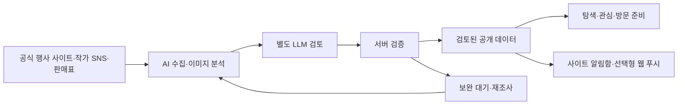

# 부스하나: AI 서비스 설계와 개발 과정 회고

- 작성일: 2026년 10월 13일
- 용도: AI 서비스를 설계하고 개발하며 겪은 과정을 설명하는 강연 자료
- 근거: 이 대화의 요구사항·피드백, 확인한 코드, 2026년 10월 9일 운영 검증 기록
- 코드 기준: 서브컬처 개편 및 SNS 수집 보완 버전 `0.4.0.16`

이 문서는 앞서 정리한 서비스 구조, 설계 과정, 강하게 지적받았던 문제, 기술적 어려움과 실제 검증 사례를 하나로 묶었다. 운영 검증 수치는 10월 9일 기록이며, 문서 작성일의 실시간 수집량이나 운영 상태를 새로 점검한 결과는 아니다.

## 1. 강연의 중심 이야기

강연에서는 **“AI와 함께 화면을 만드는 것에서 출발해, 사용자 행동과 데이터 수집·검증·운영까지 설계하게 된 과정”**으로 설명하면 좋다.

사용자가 강하게 지적했던 부분은 AI가 구현 과정에서 놓친 제품 판단과 검증 문제였다. 화면을 구현하는 과정에서 사용자 행동, 콘텐츠 공급 가능성, 승인한 시안과 실제 운영 화면의 일치까지 확인해야 했다.

## 2. 현재 부스하나의 구조

부스하나는 **분야별 사용자 경험을 나누고, 공통 시스템을 공유하는 구조**다.

서브컬처·박람회·축제·팝업에 각각의 진입 화면과 탐색 경험이 있고, 회원·인증·API·DB·저장 기능은 공통 기반을 사용한다. 이번 대화에서 가장 깊게 개편한 부분은 서브컬처다.

| 구성 | 역할 | 구현 |
| --- | --- | --- |
| 사용자 화면 | 행사·캐릭터·작가·상품 탐색, 관심 설정, 방문 준비, 후기, 알림 | React·TypeScript·Vite, Vercel |
| 공통 백엔드 | 로그인·권한, 조회·저장, 공개 여부 검증, 관리자·작가 운영 기능 | Java 21·Spring Boot |
| 데이터 저장 | 행사·회차·부스·작가·상품·작품·캐릭터와 관계, 수집·검토 기록 | PostgreSQL |
| AI 수집기·보완기 | 외부 자료 탐색, 정보 추출, 이미지 분석, 관계 확인, 재조사 | Python·Codex CLI, `gpt-6.1-sol` |
| 운영 기반 | API·수집기 실행, 이미지 저장, 배포·검증 | Ubuntu·Docker·Cloudflare Tunnel·GCS |

사용자가 보는 서비스와 AI가 자료를 조사하는 작업자는 분리되어 있다.



## 3. 제품 설계가 어떻게 바뀌었는가

### 3.1. 사용자 유형이 섞여 있다는 문제에서 출발했다

처음 문제는 한 서비스 안에 서로 다른 사용자들이 섞여 있다는 것이었다. 서브컬처 팬, 박람회 방문자, 데이트할 축제를 찾는 커플은 원하는 정보와 탐색 방식이 달랐다.

그래서 분야 전환을 푸터로 옮기고, 각각 별도의 서비스처럼 경험을 설계하기로 했다. 서브컬처를 우선 깊게 개편하고, 다른 분야의 경험은 같은 기반에서 구분했다.

### 3.2. 서브컬처 사용자의 탐색 경로를 네 가지로 정리했다

다음 네 가지를 사용자 행동 가설로 정리했다. 실제 사용자 비율이나 선호도를 정량적으로 검증한 결과라는 의미는 아니다.

| 탐색 경로 | 사용자의 출발점 | 필요한 정보 |
| --- | --- | --- |
| 행사 중심 | 갈 행사를 먼저 알고 있다 | 참가 부스, 작가, 판매 상품, 행사 안내 |
| 작품·캐릭터 중심 | 좋아하는 작품이나 캐릭터가 있다 | 관련 상품, 작가, 그들을 만날 수 있는 행사 |
| 작가 중심 | 좋아하는 작가가 있다 | 새 상품, 공식 계정, 참가 행사 |
| 상품 중심 | 사고 싶은 상품을 먼저 발견했다 | 제작 작가, 판매 부스, 판매 행사·날짜 |

이 과정에서 제품 설계가 **‘행사 목록’에서 ‘취향과 방문을 연결하는 서비스’로 확장**됐다.

### 3.3. 양방향 탐색을 지원하도록 데이터 구조를 바꿨다

```text
작품 → 캐릭터
작가 → 상품 ↔ 캐릭터
행사 시리즈 → 개별 회차 → 참가 부스 → 그 회차의 판매 상품
```

이 관계망은 PostgreSQL의 테이블과 JSON 필드로 구현했다.

중요한 구분은 **“작가가 그 캐릭터의 상품을 만든다”와 “이번 행사에서 그 상품을 판다”**다. 각각 별도의 근거가 필요하다. 일반 상품, 과거 판매 기록, 특정 행사에서 확인된 판매 정보를 구분해야 했다.

### 3.4. 관심 설정과 방문 준비를 구분했다

관심 설정은 DB의 작품·캐릭터를 선택하거나 직접 입력할 수 있게 했다. 캐릭터는 출처 작품과 연결해서 구분한다. 같은 이름이더라도 다른 작품의 캐릭터일 수 있기 때문이다.

직접 입력한 항목은 검증 전까지 개인 관심으로 보관한다. 직접 입력했다고 공용 DB의 확정 정보나 행사·상품 관계로 취급하지 않는다.

개인화는 사용자가 선택한 관심과 검토된 데이터 관계를 매칭하는 방식이다.

- 관심 등록: 계속 소식을 보고 싶은 대상 지정.
- 방문 목록 저장: 특정 행사·날짜에서 방문하거나 살 것 지정.
- 웹 푸시 동의: 브라우저 알림을 받을지 별도로 선택.

세 행동을 각각 별도로 구분했다.

### 3.5. 홈의 방향도 여러 차례 검토했다

검색창만 놓는 접근에서 취향 발견을 돕는 큐레이션을 검토했다. 이후 매번 캐릭터·작가·행사·상품 콘텐츠가 풍부하게 확보되는지, 그 구성을 지속적으로 운영할 수 있는지 문제를 다시 따졌다.

사용자는 이미 알고 있는 관심 캐릭터를 반복해서 보여주는 것보다, 그 관심으로 발견할 수 있는 행사·상품·작가가 중요하다고 지적했다.

현재 홈은 사용자가 마지막에 다시 선택한 **캐릭터 카드 탐색 시안**을 기반으로 하고, 아래에 관심과 연결된 행사·굿즈·작가를 보여준다. 강연에서는 중간 제안과 최종 선택을 구분해서 설명해야 한다.

## 4. AI 수집기와 보완기를 어떻게 설계했는가

### 4.1. AI 작업을 여러 단위로 나눴다

| 작업 단위 | 확인하는 내용 |
| --- | --- |
| 행사 발견 | 어떤 행사가 열리는가 |
| 행사 안내 | 정확한 회차의 날짜·장소·운영 안내 |
| 참가 부스 | 누가 참가하고 어떤 부스를 운영하는가 |
| 작가 조사 | 여러 행사에서 같은 작가인지, 공식 계정은 무엇인지 |
| 판매 정보 | 개별 상품·옵션·가격과 해당 행사 판매 여부 |
| 작품·캐릭터 분석 | 상품에 실제로 어떤 캐릭터가 표현됐는지 |
| 행사 관계 | 반복 개최 시리즈, 이전 회차와 후기 연결 |

행사 사이트 하나만 조사하는 것으로는 충분하지 않았다. 행사와 작가를 독립적으로 조사하고, 작가의 상품·판매표·SNS 자료를 분석한 뒤 관계를 연결해야 했다.

### 4.2. 추출과 검토를 분리했다

각 작업은 다음 순서로 진행한다.

```text
정보 추출
  → 추출 결과 저장
  → 별도 LLM 호출에서 원문·이미지 대조 및 검토
  → 서버 검증
  → 공개 / 보완 대기 / 반려
```

수집·추출·검토에서 `gpt-6.1-sol`을 명시적으로 사용한다. 모델을 NULL이나 기본값에 의존하지 않도록 했고, 다른 모델로 조용히 대체하지 않는다.

사용자의 결정에 따라 사람의 필수 승인 단계는 제거했다. 관리자 정정 기능은 유지했다.

같은 모델을 다른 호출에서 검토시키는 방식이므로 오류가 완전히 독립적이라고 보장할 수는 없다. 그래서 서버에서도 다음 항목을 검사한다.

- 대상 ID와 참조 관계가 유효한가.
- 캐릭터의 출처 작품이 맞는가.
- 행사 회차와 상품·부스 소속이 맞는가.
- 확정한 정보의 근거가 있는가.
- 검토한 데이터 버전과 현재 데이터가 일치하는가.
- 공개 제외·철회·수동 수정 상태를 침해하지 않는가.

### 4.3. 수집 작업을 중단 후 재개할 수 있게 했다

수집 작업은 DB 큐에 남긴다. 이미 처리한 페이지와 게시글을 기록하고, 중단 후 이어서 처리한다.

- 작업 선점과 임대 토큰으로 중복 처리를 제어한다.
- 처리 중에는 heartbeat로 작업 소유권을 유지한다.
- 임대가 만료된 작업자의 늦은 결과가 최신 데이터를 덮어쓰지 못하게 한다.
- 미완료 페이지와 확인하지 못한 이미지는 보완 대상으로 남긴다.
- 오류와 사용량 제한은 대기·재시도로 처리한다.
- 과거 데이터를 처음 가져올 때는 새 소식 알림을 보내지 않는다.

사용자는 비용·총 호출량의 상한을 두지 않기로 했다. 호출 타임아웃, 출처 접근 제한, 공급자의 실제 사용량 제한, 재시도 간격과 반복 방지 장치는 유지했다.

### 4.4. SNS 수집을 추가했다

```text
행사 부스의 작가별 원문
  → SNS 계정 후보 탐색
  → 계정 원문과 작가·부스 원문의 동일인 근거 확인
  → 별도 LLM 검토
  → 승인 계정의 게시글·판매표 이미지 수집
  → 상품·작품·캐릭터 분석
  → 정확한 행사 회차의 판매 정보 보완
```

동명 계정, 공동 부스의 다른 작가 계정, 리포스트나 인용에 등장하는 다른 작가의 이미지가 잘못 연결되지 않도록 했다.

계정별 작성자 ID, 게시글 커서와 체크포인트를 저장한다. 해당 계정의 소유자가 바뀌거나 잘못 연결됐다는 근거가 확인되면 연결을 재검토한다.

10월 9일 검증 기준으로 Bluesky 공식 공개 API를 통한 실제 수집을 확인했다. X 공식 API 수집 경로도 구현했지만 당시 운영 인증키가 없어 전체 작성자 피드는 미수집 상태였다. 포스타입·인스타그램은 접근 가능한 공개 원문을 대상으로 하고, 로그인·접근 제한을 우회하지 않는다.

## 5. 사용자가 욕했던 핵심 장면

핵심 장면은 **사용성, 시안과 운영의 불일치, 화면별 반영 누락**이었다. 아래 표현은 대화에서 나온 발언의 일부를 인용했다.

| 당시 지적 | 실제 문제 | 강연에서 설명할 교훈 |
| --- | --- | --- |
| “너시발 사용성 고려 안하니?” — 이미 관심 등록한 카드의 큰 버튼 | 상태 표시가 이미지와 탐색을 방해했다. 해제는 작은 하트로 충분했다. | 기능이 있다는 것과 쓰기 편하다는 것은 별도로 검증해야 한다. |
| “전체적으로 사용성이 미흡한거…” | 관심 설정 반복 노출 등 사용자가 이미 아는 정보를 계속 보여줬다. | 화면별 요소보다 사용자의 연속된 행동을 점검해야 한다. |
| “우리가 원래 만들었던걸아 많이 다른데” — 운영 메인 확인 | 승인한 시안과 실제 구현 결과가 달라졌다. AI가 구현하면서 의도를 다르게 해석한 문제였다. | 승인한 화면을 구현 완료의 기준으로 고정하고 실제 배포 화면과 비교해야 한다. |
| “다른탭은 이전거그냥놔둿네” | 홈을 바꾼 뒤 다른 메뉴·상세 화면까지 같은 기준으로 반영됐는지 확인하지 못했다. | 변경 범위를 페이지 목록과 사용자 경로로 관리해야 한다. |

이 문제는 AI가 코드를 만들면서 실제 사용 흐름과 운영 조건을 끝까지 확인하지 못했던 사례로 설명할 수 있다.

## 6. 욕까지는 아니었지만 설계를 크게 바꾼 지적

### 6.1. “캐릭터는 나와봐야 뭐하니?”

이미 아는 관심 대상을 반복하는 것보다, 그 관심으로 새로 발견할 수 있는 행사·상품·작가가 중요하다는 지적이었다.

개인화 화면은 사용자가 입력한 취향을 그대로 되돌려 보여주는 데 그치지 않고 다음 행동에 도움이 되는 결과를 제공해야 했다.

### 6.2. “그만한 콘텐츠가 들어가는 게 가능한가?”

예쁜 큐레이션 영역을 지속적으로 운영할 자료가 확보되는지 따져야 했다. 캐릭터·행사·상품이 매번 함께 확보된다는 보장은 없었다.

콘텐츠가 부족할 때 무엇을 보여줄지, 어떤 정보를 일반 목록으로 제공할지, 어떤 관계를 미확인으로 남길지 설계해야 했다.

### 6.3. 로고 대신 기존 3D 아이콘을 쓰자는 제안

기존 자산과 서비스 맥락을 충분히 고려하지 않고 새 디자인을 만든 문제였다. 사용자는 이미 서비스의 분야 구분에 사용하는 3D 아이콘을 재사용하는 방향을 제안했다.

### 6.4. 캐릭터 이미지는 왜 없느냐는 지적

이름과 설명을 수집하는 것만으로 사용자가 탐색할 수 있는 콘텐츠가 완성되지는 않았다.

이미지 URL 발견, 실제 파일 확보, 이미지 분석, 서비스에서의 표시 조건을 각각 확인해야 했다.

### 6.5. SNS에서도 찾아오라는 요구

행사 사이트 하나만으로 작가·상품 정보를 충분히 확보하기 어려웠다. 작가의 공개 SNS와 상품 공지를 추가로 조사하고, 그 자료를 기존 작가·행사 데이터와 연결해야 했다.

### 6.6. 다른 화면에 갔다 올 때마다 다시 불러오지 말라는 요구

화면을 다시 방문할 때 같은 정보를 계속 조회하는 동작을 공통 캐시로 개선했다. 같은 조회는 재사용하고, 관심 변경·계정 전환·명시적 새로고침 때 갱신하도록 했다.

### 6.7. 행사 상세에 행사 안내가 없다는 지적

상품·부스 탐색에 집중하면서 기본적인 방문 안내가 빠져 있었다. 행사 상세에는 날짜·장소뿐 아니라 운영 시간, 입장과 교통 등 방문 판단에 필요한 정보를 함께 제공해야 했다. 원문에서 확인할 수 없는 항목은 미확인으로 남겨야 했다.

### 6.8. 홈 화면 비교 기능을 없애라는 요구

여러 상태를 비교하기 위한 시안 도구와 실제 사용자 기능을 구분해야 했다. 시안을 검토하기 위한 비교 컨트롤은 제거하고, 관심 캐릭터가 있는 경우·작품만 있는 경우·미설정·직접 입력 등 사용자 상태에 따른 처리 자체는 서비스 흐름에서 다뤄야 했다.

## 7. 개발 과정에서 어려웠던 부분

### 7.1. 기존 DB에 없던 개념을 추가하면서 이전 데이터를 보존해야 했다

기존 DB에는 작품·캐릭터 개념과 관계가 충분하지 않았다. 새 테이블과 관계를 추가하면서 기존 행사·작가·상품 ID, 후기, 저장 정보는 보존해야 했다.

이전 문자열을 곧바로 확정 캐릭터로 변환하지 않고 재분석하는 과정도 필요했다. 새 구조를 도입해도 기존 사용자의 참조와 기록이 깨지면 안 됐다.

### 7.2. 정보가 없는 상황을 구분해야 했다

정보가 없다는 결과에도 여러 종류가 있었다.

- 실제로 판매하지 않는다.
- 아직 발표하지 않았다.
- 조사하지 못했다.
- 접근이 막혔다.
- 자료는 있지만 식별이 모호하다.

이를 전부 “없음”으로 표시하면 잘못된 안내가 된다. 작업의 성공 여부와 수집 범위의 완전성을 구분해야 했다.

### 7.3. 이미지와 상품 옵션의 해석이 복잡했다

판매표에 여러 작가와 캐릭터가 섞이고, 같은 상품에도 캐릭터별 옵션이 있었다. 실제 이미지 파일을 분석하고 상품 영역별 근거를 남겨야 했다.

판매표 전체의 태그를 모든 상품에 복사하거나, 일반 그림을 판매 상품으로 추정하면 안 됐다. 이미지 분석과 서비스 재게시 조건도 구분했다.

### 7.4. 검토 중에도 데이터가 바뀔 수 있었다

상품 내용이 변경되거나 운영자가 숨긴 정보를 예전 AI 결과로 다시 공개하지 않도록 버전과 해시를 검사해야 했다.

검토한 내용과 현재 공개할 내용이 달라지면 이전 승인을 재사용하지 않고 다시 조사하도록 했다.

### 7.5. 외부 서비스와 모델의 접근 제한이 있었다

X API 인증키 부재, 로그인·접근 제한, 모델 사용량 제한 때문에 모든 자료를 즉시 확보할 수는 없었다.

작업을 보존하고 대기·재시도하는 구조가 필요했다. 당시 서버 수집 계정의 사용량 제한은 로컬 인증 수집기가 같은 운영 작업 큐를 처리하는 방식으로 대응했다.

### 7.6. 화면 이동과 조회 캐시를 함께 다뤄야 했다

화면 이동 때마다 다시 조회하는 문제를 공통 캐시로 개선했다. 동시에 캐시 때문에 다른 계정의 정보가 남거나, 관심 변경 후 오래된 결과가 보이는 문제를 막아야 했다.

같은 조회의 재사용과 변경 이후의 갱신을 함께 설계해야 했다.

### 7.7. 시안·계획·구현·운영의 상태가 서로 달라질 수 있었다

미리보기는 가상 데이터로 사용 흐름을 검토하는 단계였다. 운영 구현에서는 기존 API·인증·DB와 실제 공개 데이터를 연결해야 했다.

그 과정에서 승인한 시안의 의도를 다르게 구현하거나 일부 화면만 바꾸는 문제가 발생했다. 계획 문서와 초기 구현 기록에는 당시 상태가 남아 있으므로, 최종 구현 여부는 코드와 실제 운영 검증 기록을 기준으로 판단해야 했다.

## 8. 강연에서 보여줄 실제 검증 사례

### 8.1. 작가 SNS 연결부터 게시글 수집 완료까지

렝넌의 공식 부스·창작자 프로필과 Bluesky 계정을 대조하고, 계정 작성자 ID를 저장했다.

이어 게시글 이미지 파일을 실제로 분석하고 별도 검토를 통과시킨 뒤 수집 체크포인트까지 갱신했다. 그 그림에는 판매 근거가 없어 상품으로 만들지 않았다.

```text
공식 부스·창작자 프로필 확인
  → Bluesky 계정 원문 대조
  → 별도 LLM 검토 승인
  → 계정·작성자 ID 저장
  → 게시글 이미지 실제 확보·분석
  → 별도 검토 승인
  → 수집 완료와 최신 게시글 체크포인트 기록
```

이 사례는 자료를 읽은 것, 계정 귀속을 확정한 것, 상품 판매를 확정한 것을 구분해 보여준다.

### 8.2. 연결 근거가 부족한 계정은 미확인으로 유지했다

아노센의 경우 동명 Bluesky 계정이 발견됐지만 공식 부스와의 연결 근거가 부족했다. 계정 귀속은 확정하지 않고 확인된 부분 정보만 승인했다.

수집량을 늘리기 위해 모호한 관계를 강제로 확정하지 않았다는 사례다.

### 8.3. 10월 9일 검증 기록

- 수집기 전체 테스트 738개 통과.
- 실제 PostgreSQL 수집 통합 테스트 79개 통과.
- CI 백엔드 테스트 443개에서 실패·오류 0건, 선택 테스트 22개 제외.
- API·수집기 실행 이미지가 검증한 소스와 일치하는지 확인.
- 배포 전후 행사 775, 참가자 5,631, 기존 상품 3,021, 작품·캐릭터 36, 공개 행사 721, 후기 3, 저장 1, 엔티티 이미지 97개가 동일함을 확인.

테스트 통과와 외부 콘텐츠의 전체 확보는 구분해야 한다. 위 수치는 해당 시점의 검증 결과이며, 모든 행사·작가·캐릭터 정보가 완전히 수집됐다는 의미는 아니다.

## 9. 강연에서 사용할 수 있는 설명 문장

아래는 앞의 과정을 바탕으로 만든 발표용 예시 문장이다.

> 처음에는 AI에게 화면을 만들어달라고 하면 서비스가 만들어질 거라고 접근했습니다. 진행하면서 사용자들이 무엇을 찾는지, 그 정보를 지속적으로 확보할 수 있는지, 수집한 정보가 맞는지까지 설계해야 했습니다. 예쁜 시안이 운영에서 달라지고, 버튼은 동작하지만 사용성이 나쁘고, 데이터는 있어도 관계가 틀리는 문제를 겪었습니다. 그래서 AI 작업을 수집·분석·검토로 나누고 서버 검증과 복구 구조를 붙였습니다. AI는 구현을 맡았고, 저는 제품의 목적과 완료 기준을 계속 판단해야 했습니다.

## 10. 참고 기록

- [서브컬처 탐색·관심 알림·수집기 개편 계획](C:/Users/071823/Desktop/BoothHana2/docs/plans/2026-10-08-subculture-notifications-collection-plan.md): 설계와 사용자 확정 사항. 초기 제안·당시 구현 상태를 포함하므로 최종 운영 완료 기록과 구분한다.
- [SNS 수집 운영 검증](C:/Users/071823/Desktop/BoothHana2/output/creator-social-20261009/verification.md): 10월 9일 배포·수집·검토·체크포인트 검증 결과.
- [SNS 수집 코드리뷰 기록](C:/Users/071823/Desktop/BoothHana2/output/creator-social-20261009/review.md): 정확성·계정 연결·재개·알림 처리 보완 내용.
- [SNS 수집 보완 PR #78](https://github.com/growthline352-jpg/boothhana/pull/78): 병합한 구현 변경.

로컬 파일 링크는 작업 PC의 경로다. 외부 공유 시 필요한 참고 문서를 함께 전달하거나 공개 가능한 자료로 교체해야 한다.
